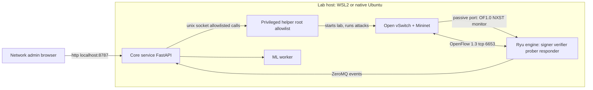
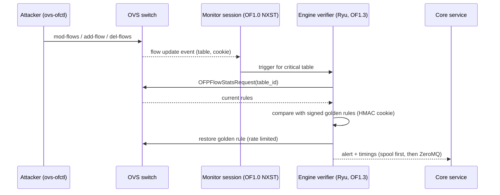
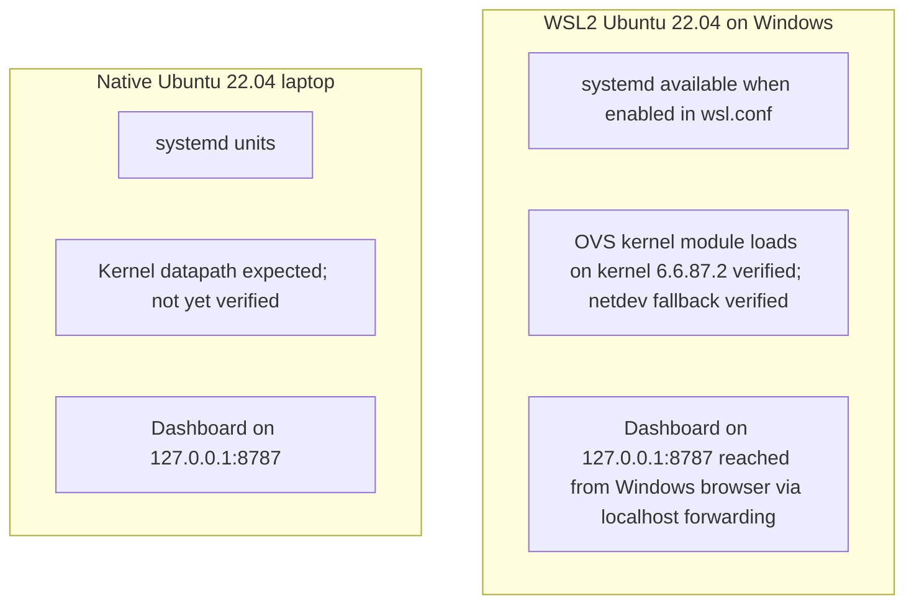
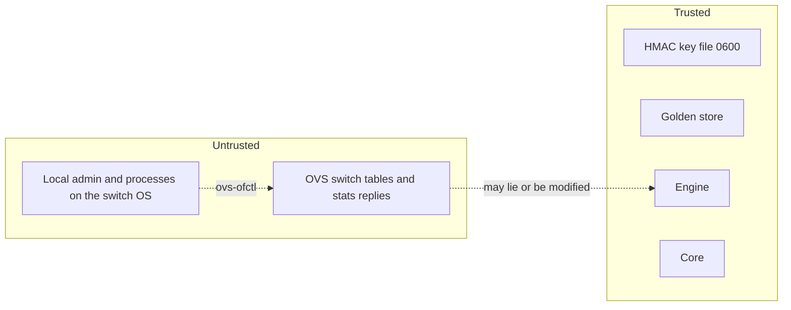
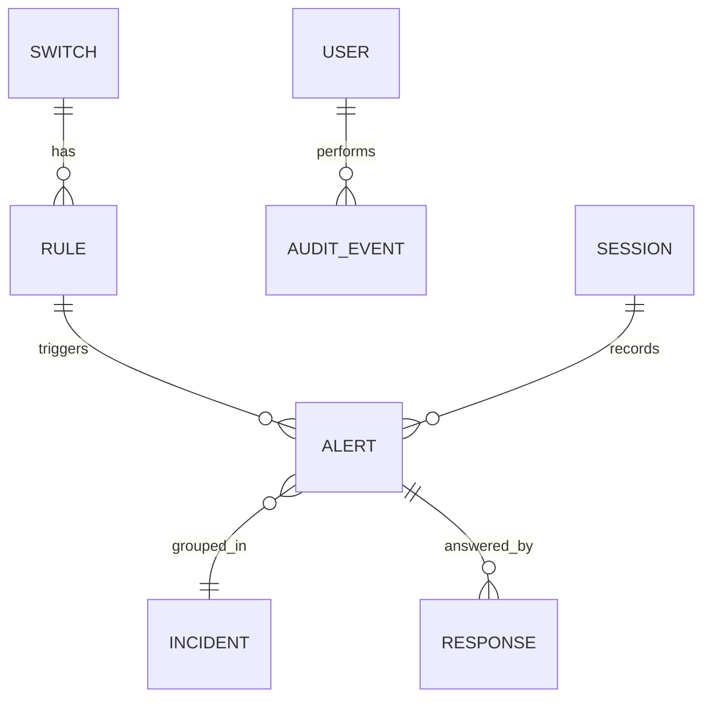
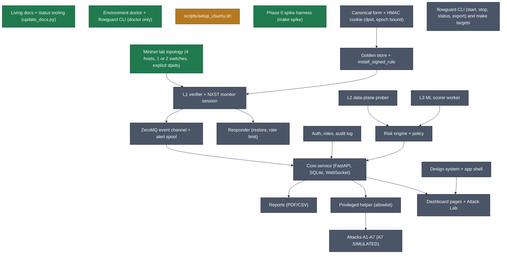

# FlowGuard architecture (as built)

This file describes what EXISTS. Every component carries a tag: `implemented` (verified by a command recorded in `docs/graphs/status.json`), `partial`, or `planned`. After Phase 0 only the lab and tooling exist; the diagrams below show the target structure with unbuilt parts marked in the tag table.

## Component tags
<!-- AUTO:component_tags -->
| Component | Tag | Phase it lands in |
|---|---|---|
| Living docs + status tooling (update_docs.py) | `implemented` | 0 |
| Environment doctor + flowguard CLI (doctor only) | `implemented` | 0 |
| scripts/setup_ubuntu.sh | `partial` | 0 |
| Mininet lab topology (4 hosts, 1 or 2 switches, explicit dpids) | `implemented` | 0 |
| Phase 0 spike harness (make spike) | `implemented` | 0 |
| Canonical form + HMAC cookie (dpid, epoch bound) | `planned` | 1 |
| Golden store + install_signed_rule | `planned` | 1 |
| L1 verifier + NXST monitor session | `planned` | 1 |
| Responder (restore, rate limit) | `planned` | 1 |
| ZeroMQ event channel + alert spool | `planned` | 1 |
| Core service (FastAPI, SQLite, WebSocket) | `planned` | 2 |
| Auth, roles, audit log | `planned` | 2 |
| Privileged helper (allowlist) | `planned` | 4 |
| Attacks A1-A7 (A7 SIMULATED) | `planned` | 4 |
| Design system + app shell | `planned` | 3 |
| Dashboard pages + Attack Lab | `planned` | 4 |
| L2 data-plane prober | `planned` | 5 |
| L3 ML scorer worker | `planned` | 5 |
| Risk engine + policy | `planned` | 5 |
| Reports (PDF/CSV) | `planned` | 6 |
| flowguard CLI (start, stop, status, export) and make targets | `planned` | 7 |
<!-- /AUTO:component_tags -->

## System context (target)

## Event data flow (L1, as designed from the Phase 0 spike)

## Deployment: WSL2 vs native Ubuntu

## Trust boundaries

In the lab the trusted and untrusted boxes share one host (see `docs/threat_model.md`).

## Data model (ER, target; migrations arrive in Phase 2)

## Generated graphs
The component graph and phase graph are generated from `docs/graphs/status.json` by `make docs`:
<!-- AUTO:components_graph -->

<!-- /AUTO:components_graph -->
