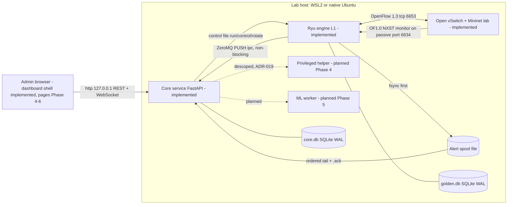
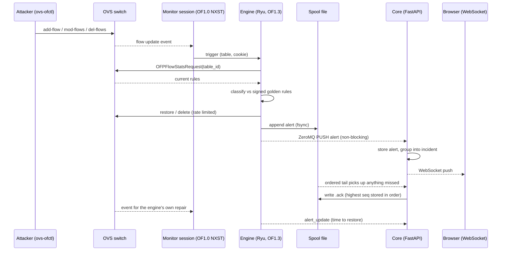
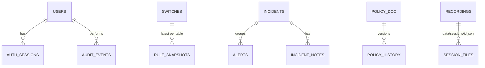
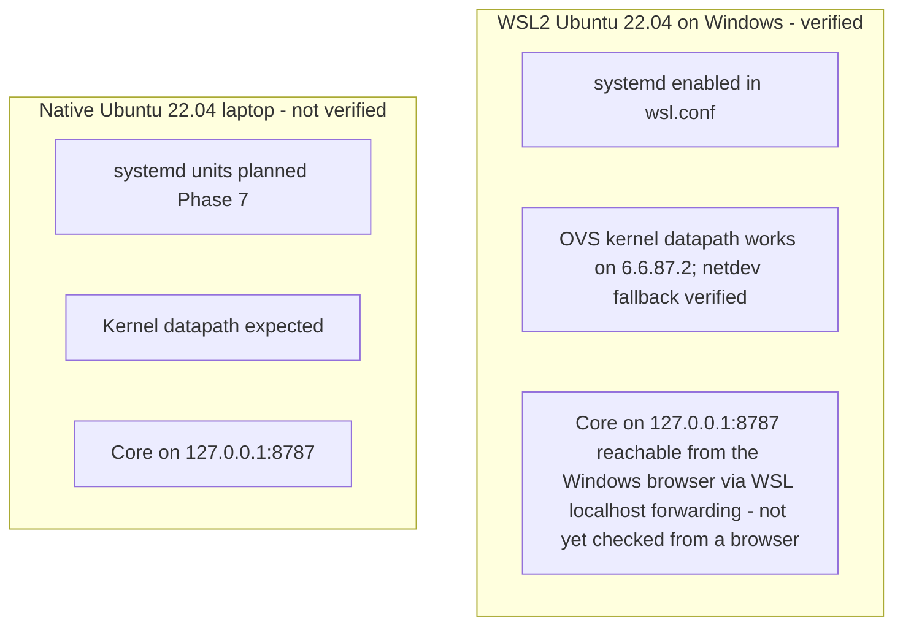
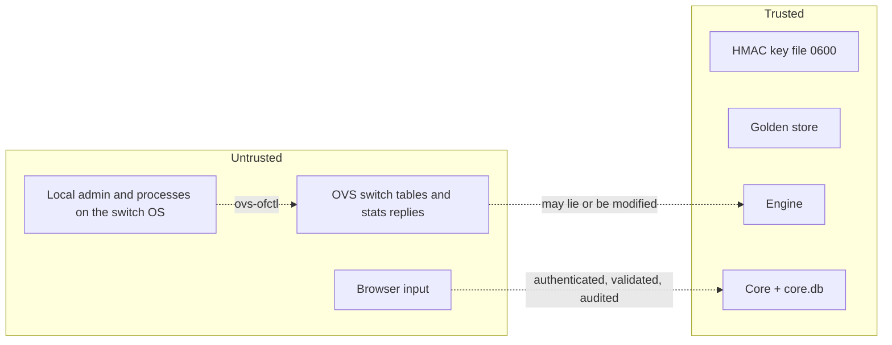
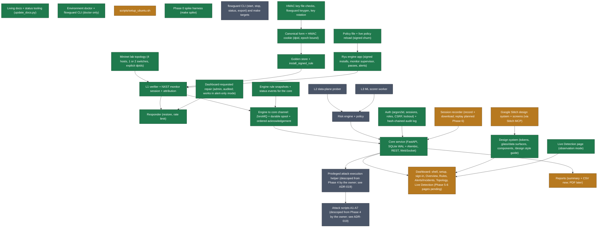

# FlowGuard architecture (as built)

This file describes what EXISTS after Phase 2. Every component carries a tag: `implemented` (verified by a command recorded in `docs/graphs/status.json`), `partial`, or `planned`. Diagrams mark planned parts explicitly.

## Component tags
<!-- AUTO:component_tags -->
| Component | Tag | Phase it lands in |
|---|---|---|
| Living docs + status tooling (update_docs.py) | `implemented` | 0 |
| Environment doctor + flowguard CLI (doctor only) | `implemented` | 0 |
| scripts/setup_ubuntu.sh | `partial` | 0 |
| Mininet lab topology (4 hosts, 1 or 2 switches, explicit dpids) | `implemented` | 0 |
| Phase 0 spike harness (make spike) | `implemented` | 0 |
| Canonical form + HMAC cookie (dpid, epoch bound) | `implemented` | 1 |
| Golden store + install_signed_rule | `implemented` | 1 |
| L1 verifier + NXST monitor session + attribution | `implemented` | 1 |
| Responder (restore, rate limit) | `implemented` | 1 |
| Engine to core channel: ZeroMQ + durable spool + ordered acknowledgement | `implemented` | 1 |
| Core service (FastAPI, SQLite WAL + Alembic, REST, WebSocket) | `implemented` | 2 |
| Auth (argon2id, sessions, roles, CSRF, lockout) + hash-chained audit log | `implemented` | 2 |
| Privileged attack-execution helper (descoped from Phase 4 by the owner; see ADR-019) | `planned` | 4 |
| Attack scripts A1-A7 (descoped from Phase 4 by the owner; see ADR-019) | `planned` | 4 |
| Design system (tokens, glass/data surfaces, components, /design style guide) | `implemented` | 3 |
| Dashboard: shell, setup, sign-in, Overview, Rules, Alerts/Incidents, Topology, Live Detection (Phase 5-6 pages pending) | `partial` | 4 |
| L2 data-plane prober | `planned` | 5 |
| L3 ML scorer worker | `planned` | 5 |
| Risk engine + policy | `planned` | 5 |
| Reports (summary + CSV now; PDF later) | `partial` | 6 |
| flowguard CLI (start, stop, status, export) and make targets | `planned` | 7 |
| Ryu engine app (signed installs, monitor supervisor, passes, alerts) | `implemented` | 1 |
| Policy file + live policy reload (signed churn) | `implemented` | 1 |
| HMAC key file checks, flowguard keygen, key rotation | `implemented` | 1 |
| Session recorder (record + download; replay planned Phase 6) | `partial` | 2 |
| Engine rule snapshots + status events for the core | `implemented` | 2 |
| Google Stitch design system + screens (via Stitch MCP) | `partial` | 3 |
| Live Detection page (observation mode) | `implemented` | 4 |
| Dashboard-requested repair (admin, audited; works in alert-only mode) | `implemented` | 4 |
<!-- /AUTO:component_tags -->

## System context

## Processes and responsibilities
| Process | Runtime | Responsibility | Status |
|---|---|---|---|
| Engine (`engine/app.py`) | Ryu 4.34, Python 3.9, eventlet | sign + install policy rules, watch the switch (OF1.0 monitor), verify tables, repair, raise alerts, publish rule snapshots and status | implemented |
| Core (`core/main.py`) | FastAPI + uvicorn, Python 3.10, asyncio | store alerts/incidents/snapshots, REST + WebSocket API, auth and roles, audit log, policy store, recordings, reports | implemented |
| Ingest thread (`core/ipc/receiver.py`) | thread inside the core | ZeroMQ PULL (bind) + ordered spool tail, acknowledgement | implemented |
| Dashboard (`web/`) | React + TypeScript (Vite dev server in development; served by the core in Phase 7) | sign-in, first-run setup, shell with live status, Overview, Rules, Alerts and Incidents, Topology, Live Detection, `/design` style guide | partial (Probes, ML, Policy, Reports, Audit, Settings pages: Phases 5-6) |
| Privileged helper | small root process | start the lab, run allowlisted attacks | descoped (ADR-019): FlowGuard does not execute attacks |
| ML worker | separate process | L3 scoring | planned (Phase 5) |

The engine and the core never share an event loop (ADR-002). The engine never blocks on the core: it writes alerts to its spool, then hands them to a bounded non-blocking queue.

## Alert path: attack to API (implemented, verified live by `tests/integration/test_core_live.py`)

## Reliability rules of the alert path (ADR-009, ADR-013)
- An alert exists on disk (spool, fsync) before anyone else hears of it.
- ZeroMQ is the fast path; the spool tail is the guaranteed path. Every record type is idempotent in the core, so getting an alert from both is harmless.
- The core acknowledges only the highest spool sequence it has processed in order, so a gap is never acknowledged.
- If the core is down, alerts stay in the spool (10 MiB x 5 files cap; overflow is counted and raised as `spool_overflow`).

## Core API surface (implemented)
Every route and its minimum role is listed and enforced by `tests/api/test_roles.py` (a new route that is not classified fails the test).
| Area | Routes | Minimum role |
|---|---|---|
| Setup and login | `GET /api/setup/status`, `POST /api/setup`, `POST /api/auth/login`, `GET /api/health` | public |
| Session | `GET /api/auth/me`, `POST /api/auth/logout`, `POST /api/auth/ws-ticket` | viewer |
| Read data | switches, rules (+summary), alerts, incidents, events, probes, ML scores, policies, sessions, reports summary, engine status, health detail | viewer |
| Triage | `POST /api/alerts/{id}/ack`, `PATCH /api/incidents/{id}`, `POST /api/incidents/{id}/notes`, audit log, policy history, CSV export, session download | analyst |
| Administration | users, `PUT /api/policies`, start/stop recordings, `POST /api/engine/rotate-key`, `POST /api/rules/repair`, `GET /api/audit/verify` | admin |
| Live stream | `WS /api/ws?ticket=` (one-time ticket from `POST /api/auth/ws-ticket`) | viewer |

OpenAPI: `/openapi.json`, interactive docs at `/docs`.

## Security model of the core (ADR-014, ADR-015)
- Passwords: argon2id. Session tokens: 256-bit random, only their SHA-256 is stored. Unknown users take the same time as wrong passwords.
- Browser: HttpOnly cookie, `SameSite=Strict`; every state-changing cookie request needs the session's CSRF token in `X-CSRF-Token`. API clients: `Authorization: Bearer`.
- Login lockout per (IP, username) after 5 failures in 5 minutes, for 60 s (in memory).
- WebSocket: one-time 30 s tickets, so the session token never appears in a URL.
- Every state change and every denial is written to a hash-chained audit log (`GET /api/audit/verify`).
- Binds to 127.0.0.1; security headers on every response; `Cache-Control: no-store` on the API.
- The policy document is stored and versioned but **not enforced** yet (`enforced: false`); the risk engine arrives in Phase 5.

## Data model (core database, implemented; migrations in `core/migrations`)

Other tables: `engine_events` (newest 5000 kept), `probe_results` and `ml_scores` (empty until Phase 5), `meta` (spool sequence, last engine status). The engine's golden store is a separate SQLite file owned by the engine.

## Deployment: WSL2 vs native Ubuntu

## Trust boundaries

In the lab the trusted and untrusted boxes share one host, and the live tests run the core as root alongside Mininet (`docs/threat_model.md`). Separate service users arrive in Phase 7.

## Generated graphs
The component graph is generated from `docs/graphs/status.json` by `make docs`:
<!-- AUTO:components_graph -->

<!-- /AUTO:components_graph -->
