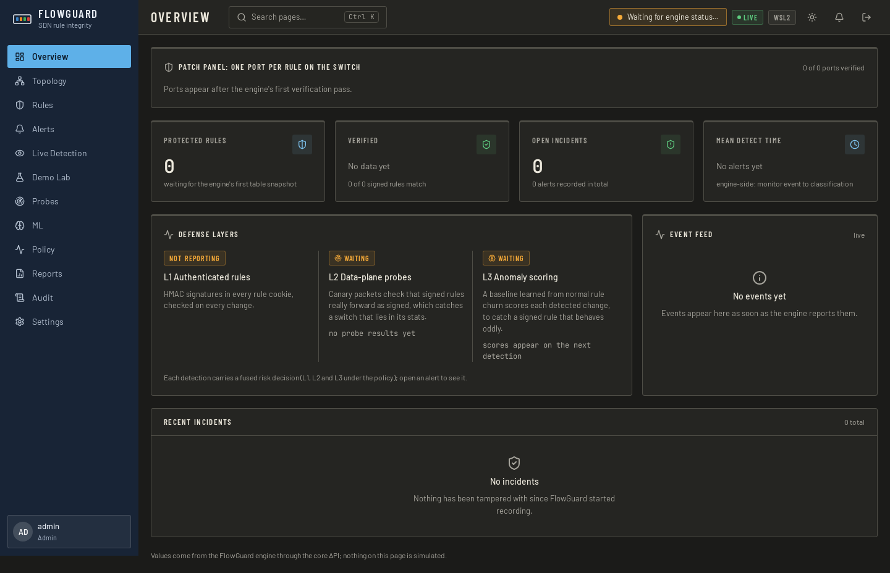
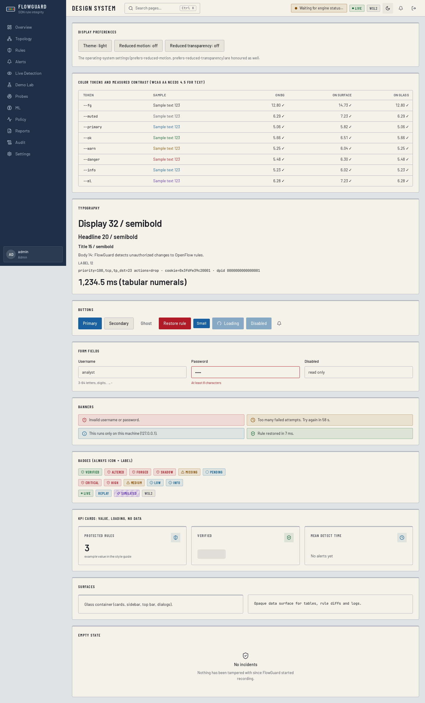
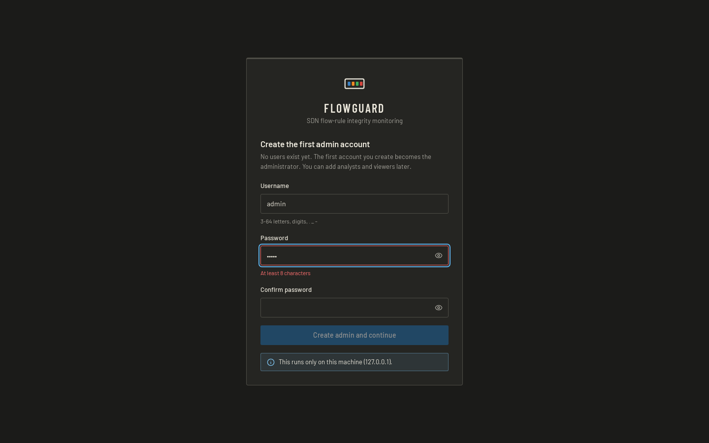
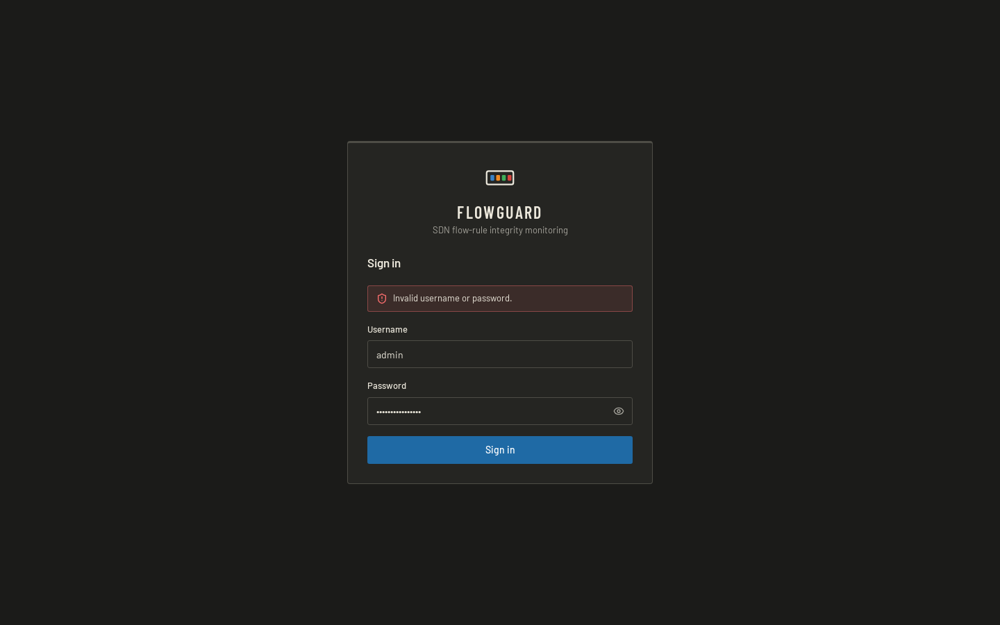
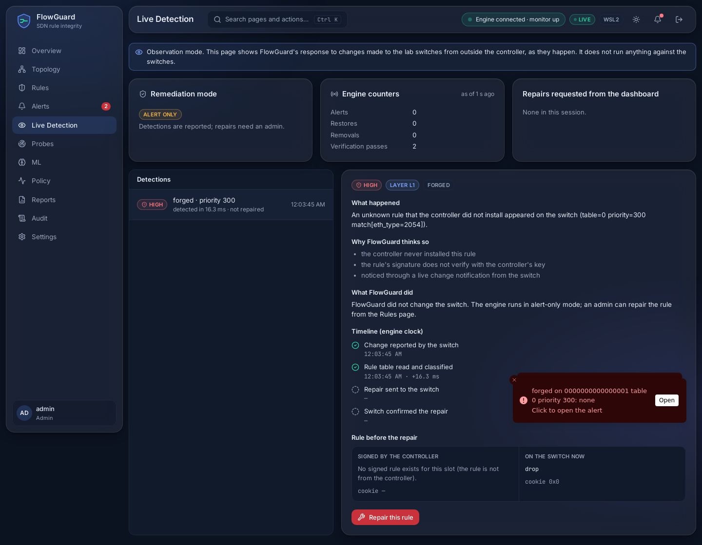
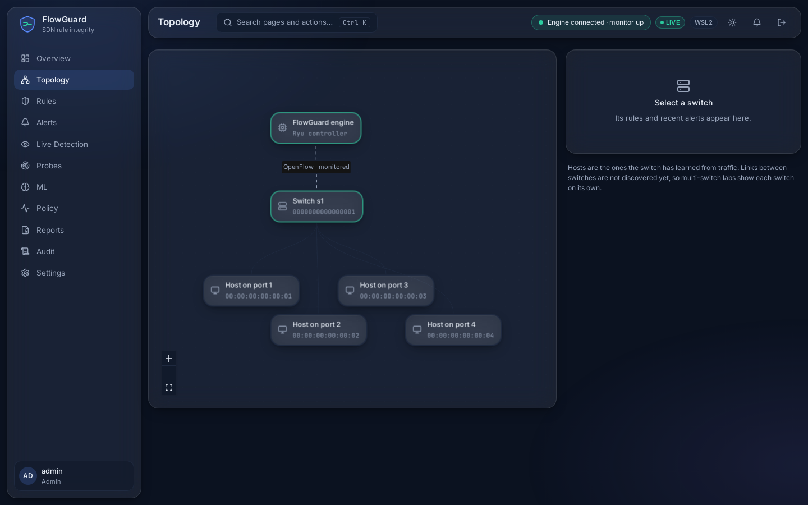
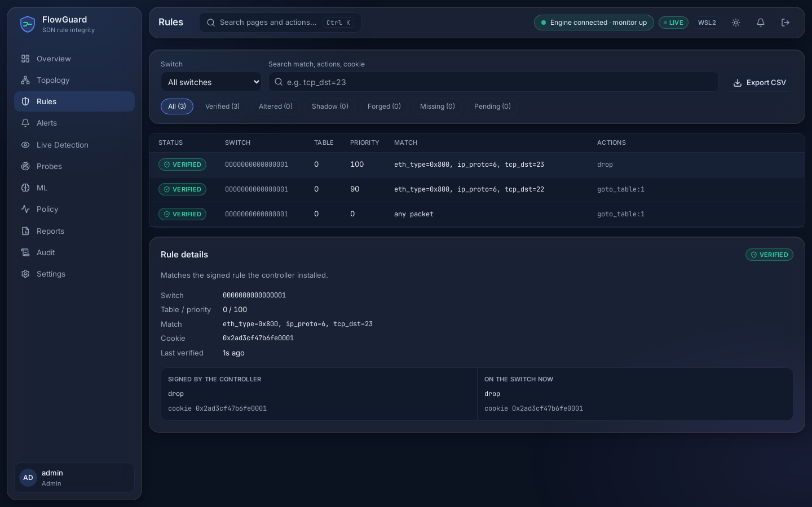
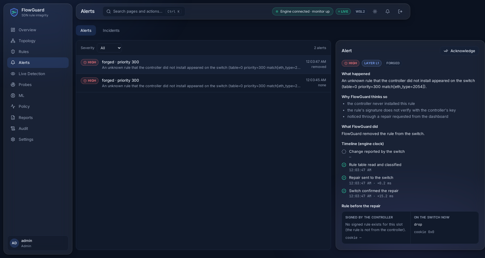

# FlowGuard

Flow-rule integrity monitoring and unauthorized network-state change detection for SDN (Ryu + Open vSwitch).

> **Status: a working prototype (Phases 0-10 built and tested on a WSL2 lab; Phase 11 release checklist partly open; see [STATUS.md](STATUS.md) and [RELEASE_CHECKLIST.md](RELEASE_CHECKLIST.md) for exactly what was verified and what was not).** One command starts the lab, the engine, the core, the website and the operator console: `sudo bin/flowguard start`. The engine and core run as unprivileged accounts. L1 signed rules, L2 canary probes, L3 anomaly scoring and a policy-driven risk engine (with port quarantine), PDF reports and session replay run on a real Open vSwitch + Mininet lab; measured results are in [docs/results.md](docs/results.md). FlowGuard does not execute attacks (ADR-019); the Demo Lab page is a labelled simulation. Not verified: native Ubuntu, real hardware, more than two switches.

## What it does
1. **L1 authenticated rules:** an HMAC tag in the 64-bit OpenFlow `cookie` of every controller-installed rule; a verifier flags forged, altered, shadowing and missing rules and restores the signed rule.
2. **L2 data-plane probing:** canary packets verify real forwarding behavior (catches a switch that lies in stats replies).
3. **L3 ML anomaly scoring:** scores rule-change events and traffic shifts to catch signed-but-malicious rules. ML alone never deletes rules.
4. A **risk engine** fuses the three signals under an editable policy (dry run first; ML alone never repairs; a failed signature never scores below the restore threshold; optional port quarantine); a **website** and a **Streamlit console** show it live, and a **Demo Lab** page simulates tampering on a four-switch topology for presentations.

Honest scope: see [docs/threat_model.md](docs/threat_model.md) (including the lab limitation that controller, key and switch share one host).

**Presenting or trying it on a laptop? Follow [RUN_AND_SHOW.md](RUN_AND_SHOW.md)** (install, `sudo make demo`, what to show).

## Install (Ubuntu 22.04: WSL2 or native)
```bash
git clone git@github.com:RKG765/flowguard.git flowguard && cd flowguard
sudo bash scripts/setup_ubuntu.sh     # apt packages, Python 3.9 venv for Ryu, Node 20, OVS daemons
bin/flowguard doctor                  # PASS/WARN/FAIL table with a fix for every problem
```
WSL2 notes: enable systemd (`[boot]` / `systemd=true` in `/etc/wsl.conf`, then `wsl --shutdown`). The setup was developed on kernel `6.6.87.2-microsoft-standard-WSL2`, where the Open vSwitch kernel module loads. If your kernel lacks it, FlowGuard falls back to the OVS userspace datapath.

Native Ubuntu: the same commands. It has **not** been verified there yet; see [HANDOFF.md](HANDOFF.md).

## Commands available now
| Command | What it does |
|---|---|
| `make setup` | run `scripts/setup_ubuntu.sh` |
| `make doctor` / `bin/flowguard doctor [--json] [--quick]` | environment check |
| `make docs` / `make docs-check` | regenerate / verify generated docs |
| `sudo bin/flowguard start` / `stop` / `status` / `export` | the whole prototype in one command (website :8787, console :8501); see [RUN_AND_SHOW.md](RUN_AND_SHOW.md) |
| `sudo make eval` / `sudo make test-soak` / `make test-security` | measured detection times ([docs/results.md](docs/results.md)), a soak run, security-focused tests |
| `make test` | unit + property tests (both venvs) and core API tests |
| `sudo make test-live` | live attacks (forge, modify, delete, shadow, replay, tamper-and-revert) against the real engine on a lab switch |
| `bin/flowguard keygen` | create the HMAC key file (mode 0600, outside the repo) |
| `make run-core` | core API on http://127.0.0.1:8787 (`/docs` for the OpenAPI page) |
| `make dev-web` | dashboard on http://127.0.0.1:5173 (needs `make run-core`; first visit opens the first-run admin setup) |
| `make test-e2e` | browser tests with accessibility checks |
| `make spike` | re-run the Phase 0 feasibility spikes (root) |

`start`, `demo`, `eval`, `test-e2e`, `test-security`, `test-soak` are planned and exit with code 2.

## Documentation
[STATUS.md](STATUS.md) · [HANDOFF.md](HANDOFF.md) · [ARCHITECTURE.md](ARCHITECTURE.md) · [DECISIONS.md](DECISIONS.md) · [ROADMAP.md](ROADMAP.md) · [TESTING.md](TESTING.md) · [CHANGELOG.md](CHANGELOG.md) · [docs/spike_findings.md](docs/spike_findings.md) · [docs/threat_model.md](docs/threat_model.md)

## Screenshots (captured by the Playwright runs; "live engine" ones are from a real Mininet lab)
| Overview (dark) | Design system (light) |
|---|---|
|  |  |
| First-run setup | Sign-in error |
|  |  |
| Live Detection (live engine) | Topology (live engine) |
|  |  |
| Rules (live engine) | Alerts after a dashboard repair |
|  |  |

## Phase progress
<!-- AUTO:phase_table -->
| # | Phase | Status | Started | Finished |
|---|---|---|---|---|
| 0 | Environment doctor and feasibility spike | done | 2026-10-14 | 2026-10-14 |
| 1 | Engine L1 (signer, store, verifier, responder) | done | 2026-10-14 | 2026-10-14 |
| 2 | Core service, API, storage, auth | done | 2026-10-14 | 2026-10-14 |
| 3 | Design system and dashboard shell | done | 2026-10-14 | 2026-10-14 |
| 4 | Core pages + Live Detection (tag demo-v0; attack execution descoped) | done | 2026-10-14 | 2026-10-15 |
| 5 | L2 prober, L3 ML, risk engine, lying switch (tag novelty-complete) | done | 2026-11-16 | 2026-11-17 |
| 6 | Remaining pages, reports, polish | done | 2026-11-16 | 2026-11-17 |
| 7 | Packaging and hardening | in_progress | 2026-11-17 | - |
| 8 | Evaluation and docs | done | 2026-11-17 | 2026-11-17 |
| 9 | Rigorous testing (full QA pass) | in_progress | 2026-11-17 | - |
| 10 | Persona-based review | done | 2026-11-17 | 2026-11-17 |
| 11 | Fix loop and release gate | in_progress | 2026-11-17 | - |
<!-- /AUTO:phase_table -->
