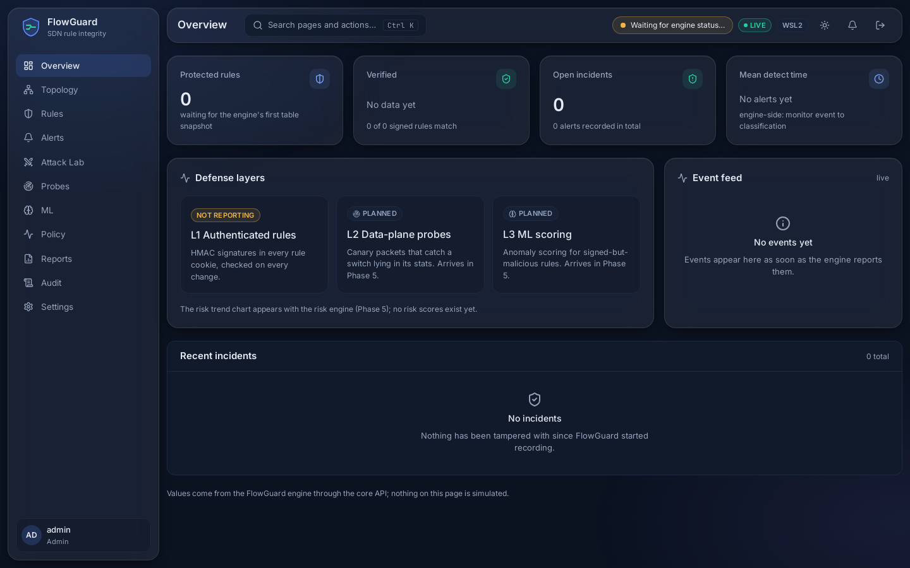
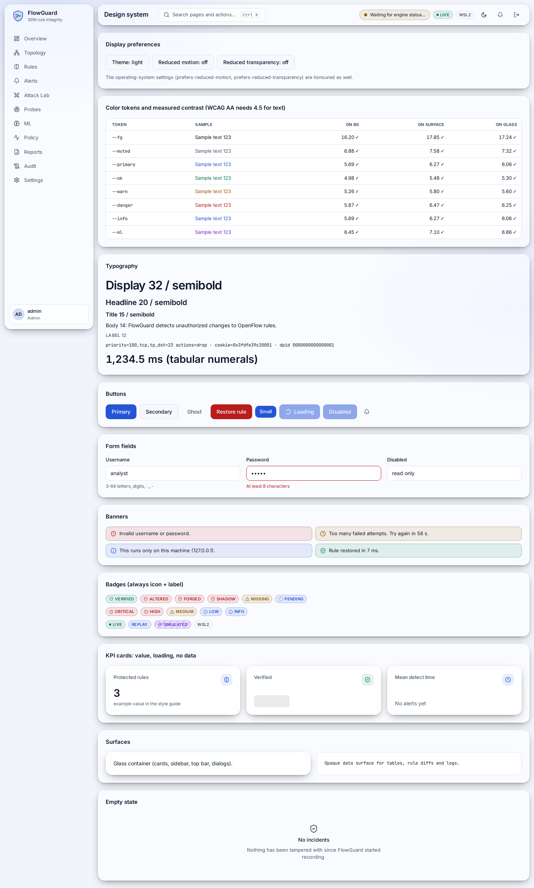
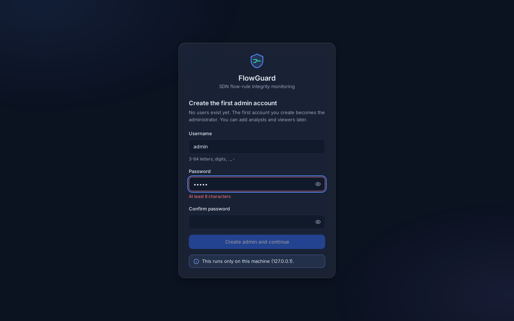
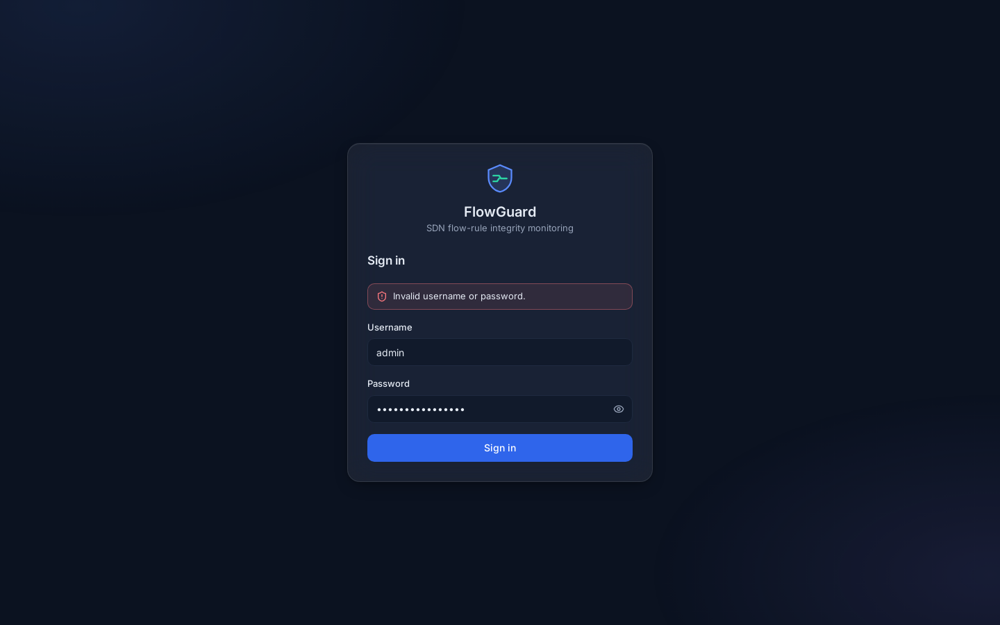

# FlowGuard

Flow-rule integrity monitoring and unauthorized network-state change detection for SDN (Ryu + Open vSwitch).

> **Status: Phases 0-3 of 11 done.** The L1 engine (signed rules, event-driven detection, automatic repair), the core API service (storage, REST + WebSocket, auth with roles, audit log) and the dashboard shell (design system, sign-in, first-run setup, live Overview) work on WSL2 and are covered by tests. The Rule Inspector, Alerts, Topology and Attack Lab pages (Phase 4), L2, L3 and the risk engine (Phase 5) are **not built yet**. Exactly what was verified is in [STATUS.md](STATUS.md).

## What it will do
1. **L1 authenticated rules:** an HMAC tag in the 64-bit OpenFlow `cookie` of every controller-installed rule; a verifier flags forged, altered, shadowing and missing rules and restores the signed rule.
2. **L2 data-plane probing:** canary packets verify real forwarding behavior (catches a switch that lies in stats replies).
3. **L3 ML anomaly scoring:** scores rule-change events and traffic shifts to catch signed-but-malicious rules. ML alone never deletes rules.
4. A **risk engine** fuses the three signals; a **web dashboard** with an Attack Lab shows it live on real Open vSwitch + Mininet traffic.

Honest scope: see [docs/threat_model.md](docs/threat_model.md) (including the lab limitation that controller, key and switch share one host).

## Install (Ubuntu 22.04: WSL2 or native)
```bash
git clone git@github.com:RKG765/flowguard.git flowguard && cd flowguard
sudo bash scripts/setup_ubuntu.sh     # apt packages, Python 3.9 venv for Ryu, Node 20, OVS daemons
bin/flowguard doctor                  # PASS/WARN/FAIL table with a fix for every problem
```
WSL2 notes: enable systemd (`[boot]` / `systemd=true` in `/etc/wsl.conf`, then `wsl --shutdown`). The setup was developed on kernel `6.6.87.2-microsoft-standard-WSL2`, where the Open vSwitch kernel module loads. If your kernel lacks it, FlowGuard falls back to the OVS userspace datapath.

Native Ubuntu: the same commands. It has **not** been verified there yet; see [HANDOFF.md](HANDOFF.md).

## Commands available now
| Command | What it does |
|---|---|
| `make setup` | run `scripts/setup_ubuntu.sh` |
| `make doctor` / `bin/flowguard doctor [--json] [--quick]` | environment check |
| `make docs` / `make docs-check` | regenerate / verify generated docs |
| `make test` | unit + property tests (both venvs) and core API tests |
| `sudo make test-live` | live attacks (forge, modify, delete, shadow, replay, tamper-and-revert) against the real engine on a lab switch |
| `bin/flowguard keygen` | create the HMAC key file (mode 0600, outside the repo) |
| `make run-core` | core API on http://127.0.0.1:8787 (`/docs` for the OpenAPI page) |
| `make dev-web` | dashboard on http://127.0.0.1:5173 (needs `make run-core`; first visit opens the first-run admin setup) |
| `make test-e2e` | browser tests with accessibility checks |
| `make spike` | re-run the Phase 0 feasibility spikes (root) |

`start`, `demo`, `eval`, `test-e2e`, `test-security`, `test-soak` are planned and exit with code 2.

## Documentation
[STATUS.md](STATUS.md) · [HANDOFF.md](HANDOFF.md) · [ARCHITECTURE.md](ARCHITECTURE.md) · [DECISIONS.md](DECISIONS.md) · [ROADMAP.md](ROADMAP.md) · [TESTING.md](TESTING.md) · [CHANGELOG.md](CHANGELOG.md) · [docs/spike_findings.md](docs/spike_findings.md) · [docs/threat_model.md](docs/threat_model.md)

## Screenshots (captured by the Playwright run, real UI with no engine attached)
| Overview (dark) | Design system (light) |
|---|---|
|  |  |
| First-run setup | Sign-in error |
|  |  |

## Phase progress
<!-- AUTO:phase_table -->
| # | Phase | Status | Started | Finished |
|---|---|---|---|---|
| 0 | Environment doctor and feasibility spike | done | 2026-10-14 | 2026-10-14 |
| 1 | Engine L1 (signer, store, verifier, responder) | done | 2026-10-14 | 2026-10-14 |
| 2 | Core service, API, storage, auth | done | 2026-10-14 | 2026-10-14 |
| 3 | Design system and dashboard shell | done | 2026-10-14 | 2026-10-14 |
| 4 | Attack Lab and core pages (tag demo-v0) | not_started | - | - |
| 5 | L2 prober, L3 ML, risk engine, lying switch (tag novelty-complete) | not_started | - | - |
| 6 | Remaining pages, reports, polish | not_started | - | - |
| 7 | Packaging and hardening | not_started | - | - |
| 8 | Evaluation and docs | not_started | - | - |
| 9 | Rigorous testing (full QA pass) | not_started | - | - |
| 10 | Persona-based review | not_started | - | - |
| 11 | Fix loop and release gate | not_started | - | - |
<!-- /AUTO:phase_table -->
