# FlowGuard study guide

Written for the four of you before the viva. Everything here comes from the project's own files (README, STATUS, DECISIONS, ARCHITECTURE, QA_REPORT, SECURITY_REVIEW, docs/results.md, spike_findings.md) and from the code. Numbers are the ones the project measured. Where something is not done or not proven, this guide says so, because that is also what you should say.

Repository: `/home/rkg/flowguard` inside WSL (Ubuntu-22.04). From Windows: `\\wsl.localhost\Ubuntu-22.04\home\rkg\flowguard`. GitHub: https://github.com/RKG765/flowguard

How to read the diagrams: every diagram is Mermaid. VS Code (Markdown Preview Mermaid Support extension), GitHub and most markdown viewers draw them. If your viewer shows code instead, paste the block into https://mermaid.live.

## Contents
0. The 60-second version
1. Concepts you must explain
2. Problem, objectives, threat model
3. How a detection works, step by step
4. Architecture (diagrams)
5. The website and the console
6. Results, tests, reviews
7. How to open and run the project from WSL
8. What every file contains
9. Literature, gap, novelty
10. Limitations
11. Questions the professor may ask, with answers
12. Self-test (cover the answers and try)
13. Slide-by-slide: what they may ask
14. Glossary
15. Numbers cheat sheet
16. Things not to say

---

## Part 0. The 60-second version

In a software-defined network (SDN) a central controller decides what each switch should do, and each switch keeps that decision as a list of flow rules in its flow table. The switch obeys the table. If someone with access to the switch adds, edits or deletes a rule directly (one `ovs-ofctl` command is enough), the switch changes behaviour and the controller is never told.

FlowGuard closes that gap. The controller stamps every rule it installs with a secret-keyed tag (an HMAC) hidden inside the rule's 64-bit `cookie` field. A monitor on the switch reports every table change immediately. The engine reads the table, checks every rule against the signed copy it keeps, and classifies each rule as ok, forged, altered, shadow or missing. It then restores the signed rule, usually within tens of milliseconds, and shows the operator the signed rule next to what was found. Two more layers add evidence: L2 sends test packets to check that rules really forward as signed, and L3 scores how unusual a change looks. A risk engine combines the three under an editable policy.

Measured on a real Open vSwitch lab: 40 of 40 tamperings detected, about 23 ms from change to alert (wall clock, includes script overhead), about 16 ms for the engine itself, 0 false alerts during normal policy changes.

The one sentence for "what is the real problem": the controller cannot prove that every rule in a switch's table is one it installed, and existing tools mostly check what the controller intends rather than what the switch actually holds.

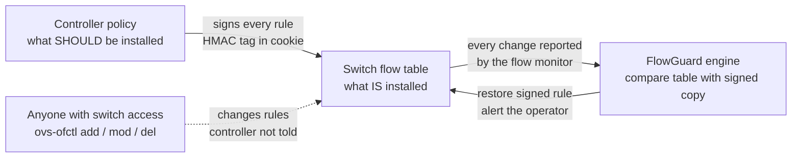

---

## Part 1. Concepts you must be able to explain

Read these in order. Each is a possible viva question.

### 1.1 SDN, control plane, data plane
- A traditional switch decides locally. In SDN the decision logic (control plane) moves to a central program, the controller. The switch (data plane) only forwards packets according to the rules it was given.
- Why it matters here: the controller is the single source of truth for policy, but the switch is where policy is enforced. FlowGuard checks that the two still agree.

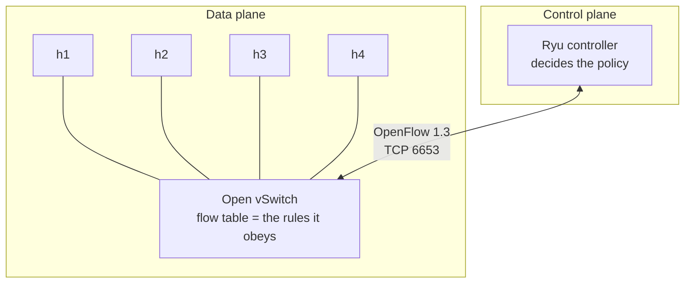

### 1.2 OpenFlow
- The protocol a controller uses to program a switch. FlowGuard uses OpenFlow 1.3 (controller to switch, TCP port 6653).
- Messages used: FlowMod (add, modify or delete a rule), FlowStatsRequest and Reply (read the table), PacketOut (inject a packet), PacketIn (switch sends a packet up), switch features and state events.

### 1.3 Flow table and flow rule
A flow rule (flow entry) has:
- match: which packets it applies to (for example `tcp_dst=23`).
- priority: higher number wins when several rules match.
- instructions/actions: what to do (drop, forward, go to another table). In OpenFlow 1.3 an empty instruction list means drop.
- cookie: a 64-bit value the controller chooses. The switch stores it and ignores it. FlowGuard carries the signature in it.
- counters, timeouts, flags: packet and byte counters, idle and hard timeouts. FlowGuard ignores these when signing because they change on their own.

### 1.4 Table 0 and table 1 (ADR-006)
- Table 0 is the security/ACL table. This is the critical table FlowGuard protects. A packet that matches nothing here goes to table 1 (`goto_table:1`).
- Table 1 is a plain learning switch (unsigned). If it misses, the packet goes to the controller.
- The lab policy (`engine/policies/lab_default.yaml`) has three signed rules in table 0: priority 100 drops TCP port 23 (telnet); priority 90 lets TCP port 22 (ssh) continue to table 1; priority 0 sends everything else to table 1.

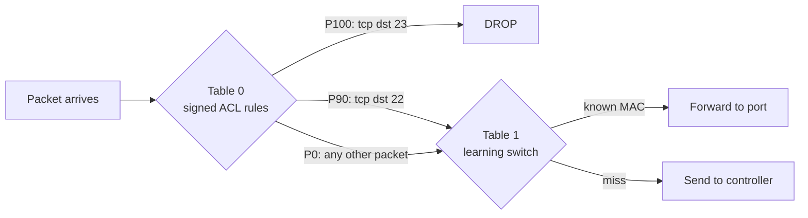

### 1.5 Controller, switch, emulator
- Controller: Ryu 4.34, a Python OpenFlow framework. FlowGuard's engine is a Ryu application (`engine/app.py`).
- Switch: Open vSwitch (OVS) 2.17, a real software OpenFlow switch.
- Mininet 2.3.0 builds a virtual network on one machine out of Linux network namespaces. The lab is one OVS switch `s1` with four hosts h1 to h4 (`topo/topo_basic.py`), optionally a second switch.
- dpid: datapath id, the switch's identity. In the lab `s1 = 0000000000000001`, `s2 = 0000000000000002`. FlowGuard sets them explicitly so a signature can be bound to one switch.
- Datapath: how OVS moves packets, kernel module or userspace (`netdev`). On this WSL2 kernel the kernel module loads; the userspace path was tested as a fallback (ADR-007).
- `ovs-ofctl`: the command-line tool that talks OpenFlow to OVS directly. It is how someone tampers with a switch outside the controller, and also how FlowGuard's monitor session is run.

### 1.6 Tamper kinds (the vocabulary of the project)
- forged: a rule on the switch that is not in the signed set.
- altered: same slot (table, priority, match) as a signed rule, but different instructions or cookie.
- missing: a signed rule that is absent from the switch.
- shadow: an unsigned rule at equal or higher priority that overlaps a signed rule and takes its traffic. Signed table-miss rules (empty match) are ignored for this test because they overlap everything.
- tamper-and-revert: a change made and undone so quickly that a later look sees nothing. FlowGuard reports it as `unattributed_change`.
- slot: the identity of a rule position, the tuple (table, priority, canonical match).

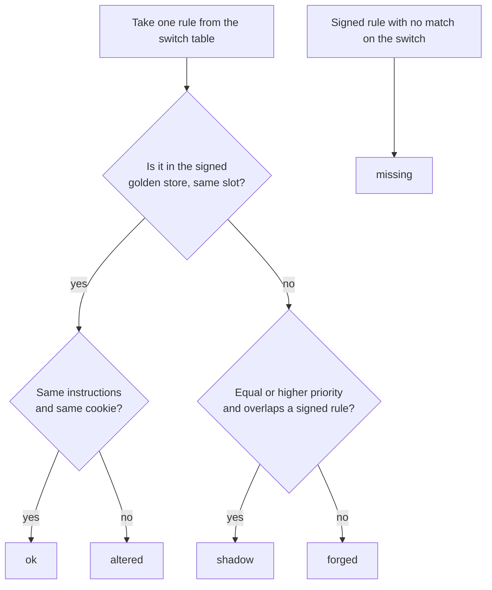

### 1.7 HMAC and the cookie signature (ADR-005)
- HMAC-SHA256: a keyed hash. Only someone holding the secret key can produce a valid tag for given bytes. Defined in RFC 2104.
- cookie (64 bits) = (tag48 << 16) | epoch16.
- tag48 = the first 48 bits of HMAC-SHA256(K_epoch, canonical_bytes).
- K_epoch = HMAC-SHA256(master_key, "flowguard-epoch" || epoch16). Each key epoch has its own derived key, so old epochs can be re-derived.
- canonical_bytes covers (dpid, epoch16, table_id, priority, normalized match, normalized instructions). It leaves out counters, durations, timeouts, flags and the cookie itself.
- Binding the dpid and the epoch stops a valid cookie being reused on another switch or after a key rotation. Binding priority, match and instructions stops it being copied onto a different rule.
- Verification is constant time.
- Key rotation: a new epoch starts; the previous epoch stays acceptable for `rotation_grace_seconds` (default 300) and is then rejected. Rotation produces no alerts.
- The key file must be mode 0600 and owned by the running user or the engine refuses to start. `FLOWGUARD_HMAC_KEY` (hex, at least 32 bytes) is the alternative.
- Why only 48 bits: the cookie is 64 bits and 16 are the epoch. The project's reasoning: forging a tag needs about 2^47 expected online guesses, and the verifier restores on first sight, so the realistic attack is copying or replaying a valid cookie, which the binding addresses.

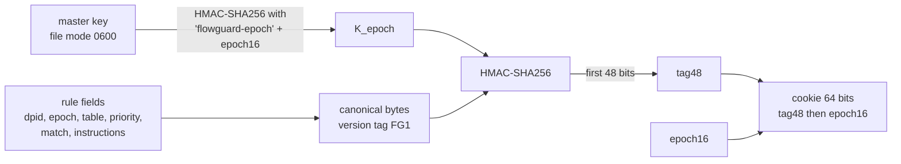

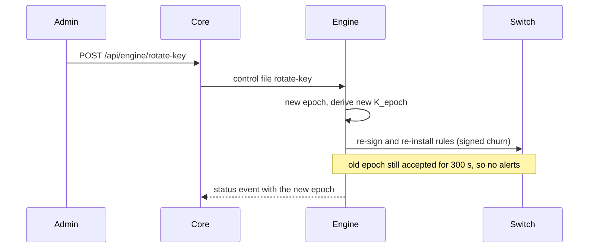

### 1.8 Canonical form (engine/canonical.py)
The same logical rule must always give the same bytes, however the match fields were ordered or spelled (MAC, IP and port formats, masks), and whether it came from the policy file or from a switch stats reply. That is what makes "recompute the tag and compare" possible. If a rule cannot be normalized the engine raises `CanonicalError` and never acts destructively on it (it alerts only).

### 1.9 Golden store (engine/store.py)
The engine's own SQLite database (WAL mode) of the signed rules every switch should hold, keyed by (dpid, table_id, priority, canonical match). Cookies are stored as 16-digit hex text because SQLite integers are signed 64-bit. Every install goes through `install_signed_rule`, which writes the store first, so the store is never behind the switch.

### 1.10 Event-driven detection versus polling (ADR-004)
- Polling means reading the table every N seconds. A change made and undone between two reads is invisible.
- The Phase 0 spike measured this: a quick tamper-and-revert (two `mod-flows` about 40 ms apart) was caught 30 of 30 times by the monitor and 0 of 30 by polling every 0.5 s on the kernel datapath. On the userspace datapath it was 10 of 10 against 0 of 10.
- How the monitor works: OVS offers a Nicira extension, NXST_FLOW_MONITOR, that pushes an event for every rule change. This OVS rejects the standard OpenFlow 1.4 monitor and rejects the Nicira one over OpenFlow 1.3, but it accepts it over an OpenFlow 1.0 session on a passive port (`ptcp:6634`; the second switch uses 6635). So the engine runs `ovs-ofctl monitor tcp:127.0.0.1:<port> watch:!initial` as a supervised subprocess and uses each event as a trigger.
- The event does not carry instructions or priority, so a trigger causes a targeted `OFPFlowStatsRequest(table_id=0)` over the OpenFlow 1.3 connection. That reply is the ground truth.
- A slow reconcile poll (default every 5 s) remains as a safety net if the monitor drops.

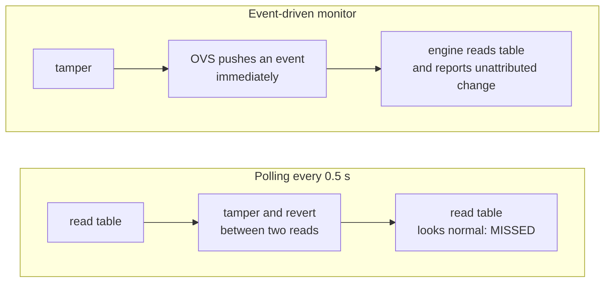

### 1.11 Grace window and attribution (ADR-011)
The engine's own FlowMods also produce monitor events and briefly make the switch differ from the signed store. The engine records every FlowMod it sends in a `Pending` set and does not judge those slots for `grace_window_ms` (default 500 ms). Detail the professor may probe: it exempts by slot (table, priority, match), not by cookie. The first live run showed that exempting by cookie let an attacker copy a signed cookie onto a different rule and hide inside the grace window. Every attributed event also schedules a verification pass after the window.

### 1.12 L2 canary probes (ADR-022, engine/prober.py)
- Problem: L1 trusts what the switch reports about its own table. A switch that lies in its stats replies, or has a rule that is listed but not acting, passes L1 while forwarding wrongly.
- Method: for each signed rule in the critical table, inject a tagged packet with PacketOut to `OFPP_TABLE` that the signed policy says must hit that rule. Then check that (a) that rule's packet counter rose by the number of probes sent, and (b) a packet that should have been dropped did not come back to the controller.
- Each probe carries a marker `PROBE_MARK:<nonce>:<index>;` with a random per-cycle nonce, and a returning probe only counts while that cycle runs, so a host cannot forge or replay a verdict. Probe packets use locally administered MAC addresses and are never flooded or learned.
- Coverage: IPv4 and IPv6 TCP/UDP, ICMPv4 echo, ARP, rules bound to an ingress port, exact MAC matches, masked addresses. Anything else (VLAN, MPLS, metadata) is skipped, never guessed.
- Limit: a switch that fakes both the counters and the PacketIn is out of scope.

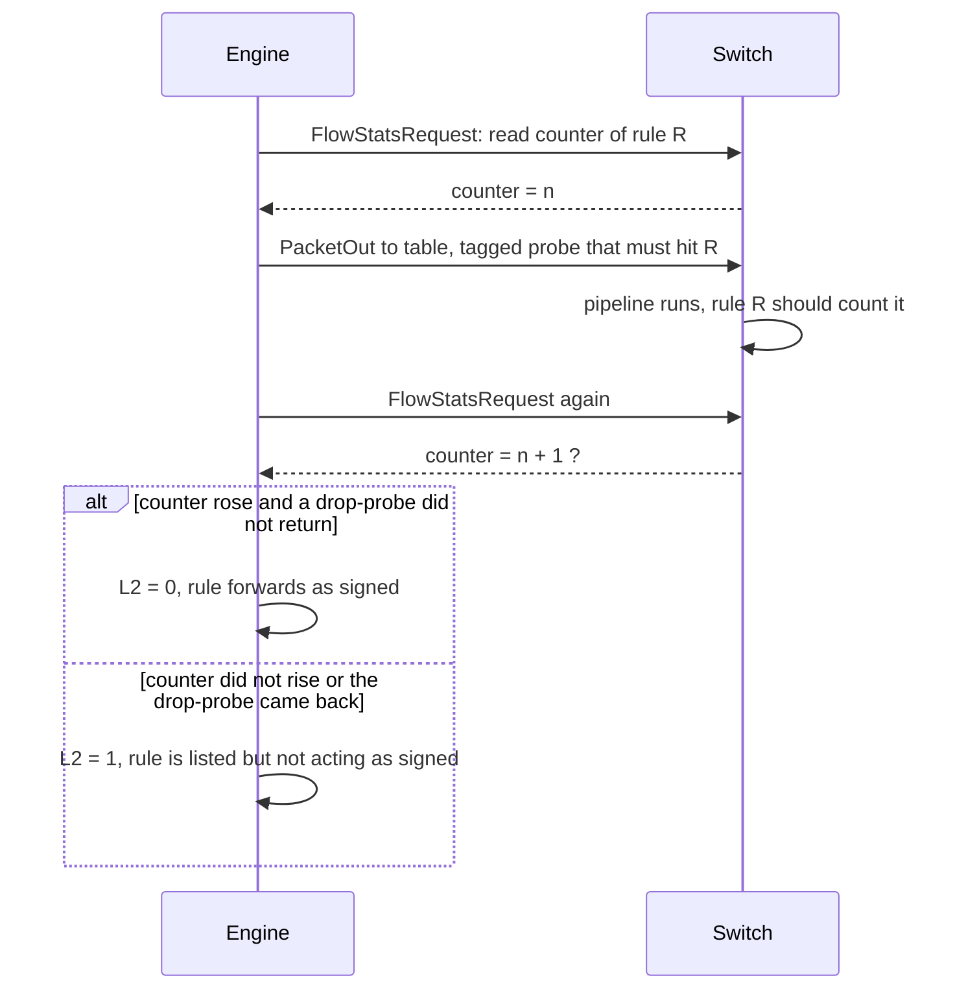

### 1.13 L3 anomaly scorer (engine/anomaly.py)
- It is a robust statistical baseline, not a neural network. Pure Python, no numpy.
- It learns what normal rule churn looks like from the engine's own legitimate signed installs and retirements, then scores each new change event between 0 and 1, with reasons.
- Three features: how many changes in the last 60 seconds (rate), how far the priority is from the usual priorities, and how rare the action class is (drop, goto, forward). Each becomes a robust z-score using the median and the MAD (median absolute deviation; 1.4826 x MAD approximates sigma), is squashed to [0, 1], and the features are combined as a noisy-OR, so one strongly unusual feature is enough.
- An unsigned rule scores 0.6 by itself ("the rule is not signed by the controller").
- Until it has 8 samples it says "baseline still learning" and scores stay low. The baseline is a sliding window of at most 2000 samples.
- In the real run on 2026-11-19 the injected rule got 0.60, exactly the unsigned-rule part, because the baseline had not yet seen 8 changes.
- Purpose: catch what L1 cannot, a rule that is correctly signed but behaves unlike anything seen before (threat T7).

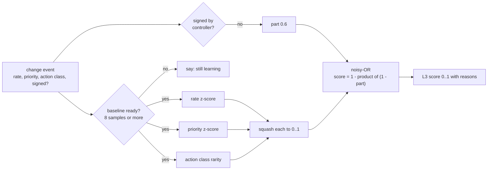

### 1.14 Risk engine (engine/risk.py)
- L1 is 0 or 1 (signature check failed or not). L2 is 0 (forwards as signed) or 1 (does not). L3 is in [0, 1].
- Fused score = weighted mean. Default weights l1 1.0, l2 0.8, l3 0.4. An L1-only finding therefore scores 1.0 / 2.2 = 0.45.
- Default thresholds: alert 0.3, restore 0.5, quarantine 0.8 (must satisfy alert <= restore <= quarantine).
- Severity classes low, medium, high, critical map to actions: restore_and_alert, quarantine_port, alert_only, none. Defaults: critical and high restore_and_alert, medium and low alert_only.
- Two safety rules are in code, not in the policy:
  1. A signed rule that fails verification never scores below the restore threshold (otherwise 0.45 would stop automatic repair, which the security review found).
  2. ML alone never repairs: with no L1 or L2 evidence the action is capped at alert_only.
- `dry_run` records what would happen but the engine does nothing (`effective_action = none`). The default policy has dry run on.
- Port quarantine drops everything arriving on one port using a reserved-priority rule (priority 65000 and above is reserved; policy files may not use it). Only a rule found on the switch can name the port, never a missing signed rule, and an admin can release the port from the Policy page.

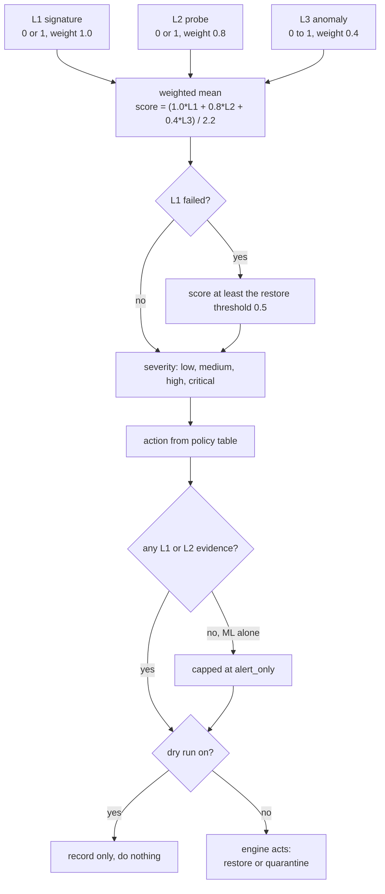

### 1.15 Responder (engine/responder.py)
- restore = re-install the signed rule with OFPFC_ADD, which atomically replaces an altered rule or recreates a missing one (no window where the rule is absent).
- delete = OFPFC_DELETE_STRICT of a forged or shadow rule.
- Never delete on a mismatch it could not verify.
- Rate limit: 30 repairs per switch per minute (sliding 60 s window), then it only alerts (`restore_rate_limited`). This stops an attacker making the engine fight in a loop, and it is why a flood of 45 unsigned rules is removed gradually.
- `response_mode: alert_only` is the dry run for the engine; an admin repairs from the dashboard.

### 1.16 The alert path and why no alert is lost (ADR-002, 009, 013)
1. The engine appends the alert to a spool file (`alerts.jsonl`) and calls fsync before anything else.
2. It hands the alert to a bounded in-memory queue and pushes it over ZeroMQ (PUSH/PULL on a Unix socket) with a non-blocking send, so the Ryu loop never waits on the core. On queue overflow events are dropped and counted.
3. The core receives on the fast path (ZeroMQ PULL) and also tails the spool files in order.
4. Every record type is idempotent, so receiving an alert on both paths is harmless.
5. Only the spool tail acknowledges, by writing the highest sequence it has processed in order into `<spool>.ack`, so a gap is never acknowledged.
6. If the core is down, alerts stay in the spool. Rotation at 10 MiB, 5 files (50 MiB cap); when the oldest file is dropped the unacknowledged records are counted and a synthetic `spool_overflow` alert is raised. A torn last line left by a crash is healed on open.

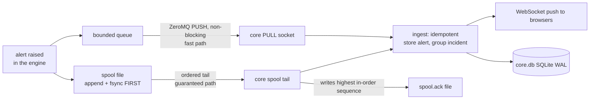

### 1.17 Security concepts in the core (ADR-014, 015, 018, 023)
- argon2id password hashing; unknown users take the same time as wrong passwords.
- Session token: random 256-bit, only its SHA-256 is stored. Browser gets an HttpOnly, SameSite=Strict cookie; API clients may send `Authorization: Bearer`.
- CSRF: every state-changing cookie request needs the session's CSRF token in the `X-CSRF-Token` header. The UI keeps it in memory only.
- Roles: viewer < analyst < admin, enforced on every route. A test lists every route and fails if a new one is not classified (`tests/api/test_roles.py`).
- Login lockout: 5 failures in 5 minutes locks that (IP, username) for 60 s (in memory, resets on restart).
- WebSocket: one-time tickets (30 s) so the session token never appears in a URL.
- First-run setup creates the only bootstrap admin and is refused once any user exists; the last active admin cannot be disabled or demoted.
- Hash-chained audit log: each row stores sha256(previous hash + canonical row). `GET /api/audit/verify` recomputes the chain. Limit: someone with write access to the database file can rewrite the whole chain from the first edited row, so it proves in-place edits, not authenticity of the file.
- Least privilege: the engine runs as `flowguard-engine`, the core as `flowguard-core`, in group `flowguard`. Only the lab (Mininet, OVS) stays root. The key and golden store are readable by the engine only; the user database by the core only.
- Content-Security-Policy: strict (`script-src 'self'`, no inline scripts, `frame-ancestors 'none'`).

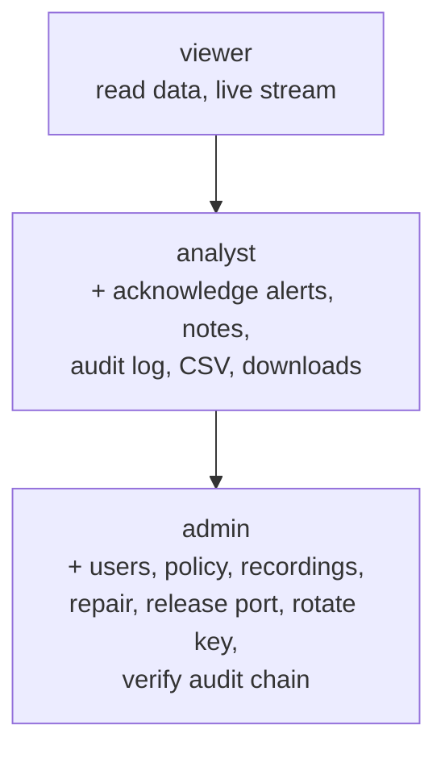

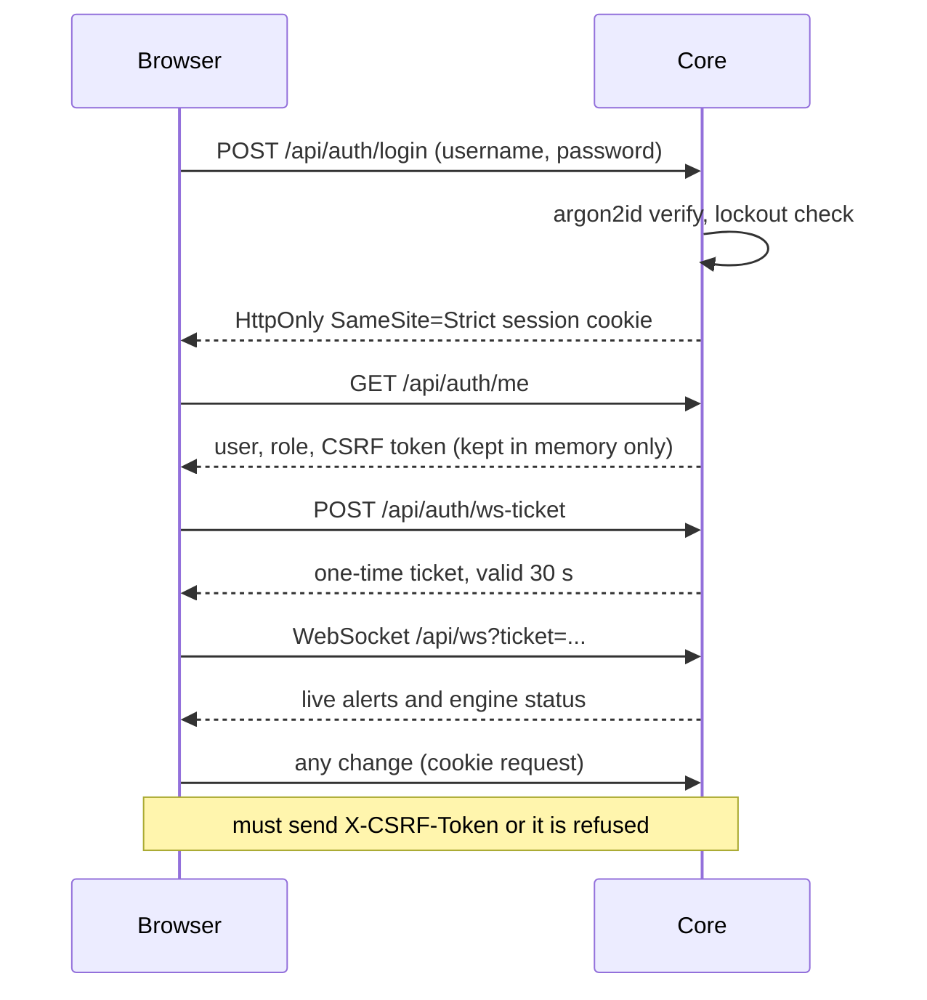

### 1.18 Other terms
- WAL (write-ahead logging): SQLite mode that lets readers and a writer work at once. Used by both databases.
- ZeroMQ: a messaging library. PUSH/PULL sockets send work one way.
- FastAPI: Python web framework for the core API. REST = request/response routes; WebSocket = a live channel the server pushes to.
- Alembic: database migration tool. The schema is in `core/migrations`.
- Playwright and axe: browser test driver and an accessibility checker (WCAG 2 A/AA).
- WSL2: Windows Subsystem for Linux. venv: an isolated Python environment (`.venv-engine` for Python 3.9 and Ryu, `.venv-core` for Python 3.10 and everything else, `.venv-ui` for Streamlit).
- uv: a fast Python package manager used to create `.venv-ui`.
- ADR: architecture decision record, one entry per important decision in `DECISIONS.md`.

---

## Part 2. Problem, objectives, threat model

### 2.1 Problem statement
In SDN the controller decides the security policy, but the switch's flow table is what enforces it. A rule can be added, changed or deleted on the switch outside the controller (management access, a compromised switch, a mistake) and the controller never notices. Four ways it shows up: forged rules, altered or deleted rules, shadow rules, and a switch that lies about its table.

### 2.2 Why it matters
- A tampered ACL rule silently bypasses the security policy.
- A forged rule looks exactly like a legitimate one when you only read the table.
- Periodic polling can miss a quick change-and-revert (0 of 30 in the spike).
- Reading a table is not proof if the switch lies.

### 2.3 Objectives
1. Sign every controller rule.
2. Detect missing, altered, shadow and forged rules in milliseconds.
3. Restore them automatically, or alert only.
4. Give operators a secure dashboard that shows signed versus found.
5. Check real forwarding with L2 probes and score changes with L3 (added in Phase 5).

### 2.4 Threat model (docs/threat_model.md)

| ID | Threat | Layer that catches it |
|---|---|---|
| T1 | A rogue admin or process adds a rule the controller never signed (forged) | L1 |
| T2 | An existing signed rule is modified (altered) | L1 |
| T3 | A signed rule is deleted (missing) | L1 |
| T4 | A higher-priority rule shadows a signed rule | L1 |
| T5 | Tamper and quick revert | L1 monitor events, `unattributed_change` |
| T6 | A switch returns falsified flow statistics | L2 canary probes |
| T7 | A valid signed rule pushed by a compromised controller app | L3 score (L1 cannot, by design) |

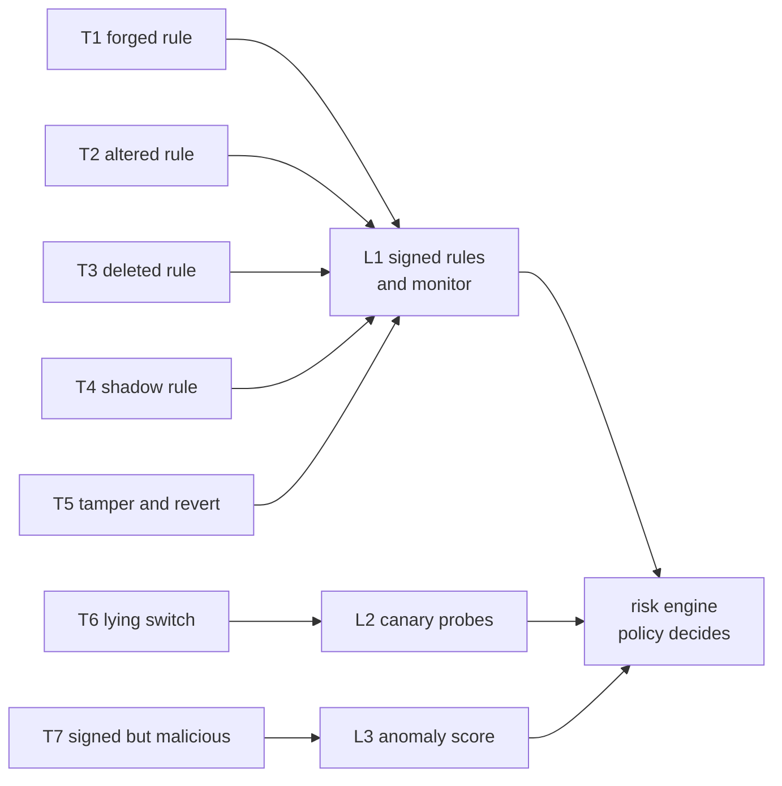

Trusted components (say this openly): the controller host, the FlowGuard services, the HMAC key, Open vSwitch itself, and the OpenFlow channel (local TCP, no TLS claimed). In the lab the controller, key, switch and attacker's shell share one host, so a root attacker on that host can read the key and forge valid cookies. The lab demonstrates detection of attackers who do not hold the key.

Out of scope: stolen controller key, physical attacks, data-plane DoS, applications on the Mininet hosts, anything outside the lab.

Blind spots the project admits: tamper-and-revert faster than the confirming stats request (covered by `unattributed_change`, probability measured only in a small sample); a monitor silently dropped (then only the 5 s poll remains); rules in table 1 are not verified; L2 samples behaviour, it does not prove it; L3 is probabilistic and slow drift can evade it.

### 2.5 Scope decision you must know: no attacks in the product (ADR-019)
FlowGuard does not execute attacks. An in-product "Attack Lab" (privileged helper, attack scripts, Run button) was stopped by an AI safety check during development, twice, and the owner chose an observation-mode page instead: Live Detection. The Demo Lab is a labelled in-browser simulation that touches no switch. The tamper changes used in tests and in the demo are plain `ovs-ofctl` commands against the lab's own switch. If asked "does your project attack networks?" the answer is no: it observes, detects and repairs.

---

## Part 3. How a detection works, step by step

Use this as your walkthrough when asked "explain the flow".

1. Install. The engine reads the policy file (`engine/policies/lab_default.yaml`), normalizes each rule to canonical form, computes the HMAC cookie for that switch and epoch, writes the golden store, and sends the FlowMod. Changing the policy file later is legitimate churn: signed installs and signed retirements, no alerts.
2. Watch. The supervised `ovs-ofctl monitor` session on the passive port prints an event for every ADDED, DELETED or MODIFIED rule with its table and cookie. `engine/monitor_parser.py` parses the text.
3. Confirm. The engine debounces a burst of events (15 ms) into one table read and sends `OFPFlowStatsRequest(table_id=0)`. The stats reply is the ground truth.
4. Classify. `engine/verifier.py` compares every observed rule with the golden rules and returns findings: missing, altered, shadow, forged, with `signature_valid` for non-golden rules (so a replayed old signed rule is visible as such). `Pending` slots are skipped during the grace window.
5. Decide. The responder plans restore or delete. The risk engine adds the L2 result and the L3 score, fuses them under the policy and decides the effective action (dry run, ML-only cap and the L1 floor apply).
6. Act. The Ryu app sends the repair (rate limited, 30 per minute per switch) or, in quarantine mode, installs a port-drop rule.
7. Report. The engine writes the alert to the spool (fsync), pushes it over ZeroMQ, and later sends an `alert_update` with the time to restore.
8. Show. The core stores the alert, groups alerts into an incident (same switch and rule slot within a time window), and pushes it over the WebSocket. The Live Detection and Alerts pages show what happened, why FlowGuard thinks so, what it did, and a timeline from the engine clock.

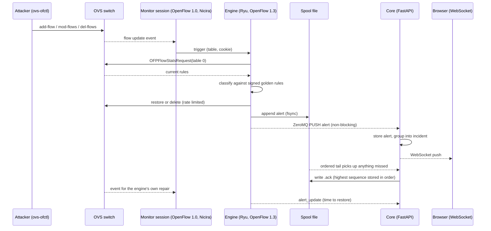

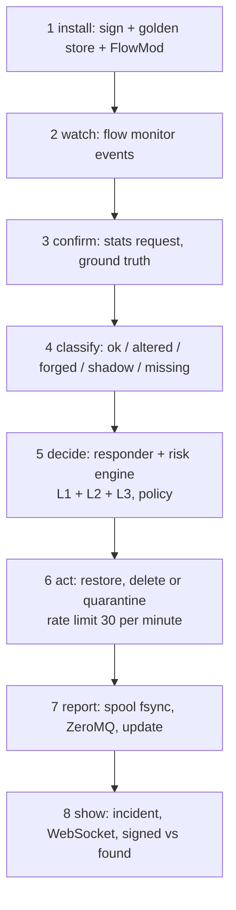

Real run, 2026-11-19, on this lab: one unsigned rule `table=0,priority=500,ip,nw_dst=10.0.0.4,actions=drop` was added to `s1` by hand. FlowGuard classified it as a `shadow` rule (it sits above a protected rule and takes its traffic), severity high, L3 score 0.60, detected in 16.3 ms, repair sent +0.2 ms, repair confirmed +0.7 ms, rule removed. Four seconds later the table was back to the three signed rules.

A rule's life as the website shows it:

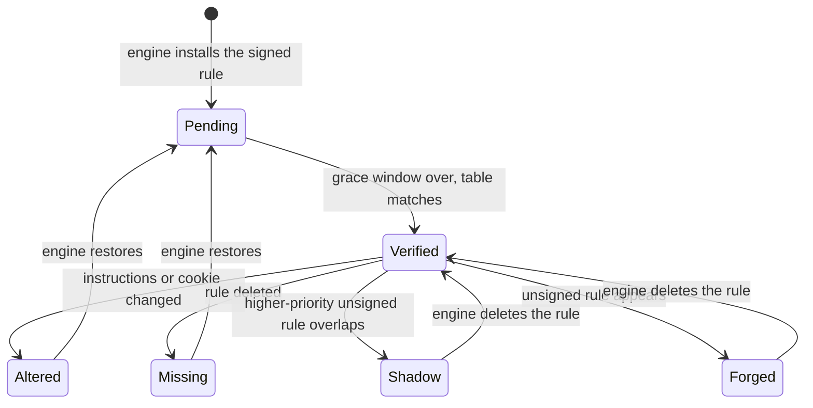

---

## Part 4. Architecture

### 4.1 Processes and ports

| Process | What it is | Runs as | Port or channel |
|---|---|---|---|
| Lab | Mininet + Open vSwitch `s1`, hosts h1 to h4 (`topo/topo_basic.py`) | root | OpenFlow to controller on 6653; passive monitor port 6634 |
| Engine | Ryu app `engine/app.py`, Python 3.9, eventlet | `flowguard-engine` | OpenFlow 1.3 to the switch; ZeroMQ + spool file to the core |
| Core | FastAPI app `core/main.py`, Python 3.10, uvicorn | `flowguard-core` | HTTP and WebSocket on 127.0.0.1:8787 |
| Website | React app built to `web/dist`, served by the core | browser | same address 8787 |
| Operator console | Streamlit `ui/streamlit_app.py` | the invoking user | 127.0.0.1:8501 |
| Dev web server | Vite, development only | user | 5173 (proxies /api to 8787) |

Everything binds to 127.0.0.1; LAN access is an explicit opt-in.

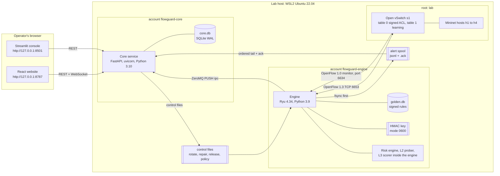

### 4.2 Data stores
- Engine side: `golden.db` (signed rules, SQLite WAL), the alert spool, the learned L3 baseline file, control files (repair requests, release requests, rotate key, risk policy) in a control folder.
- Core side: `core.db` (SQLite WAL). Tables: users, auth_sessions, audit_events, switches, rule_snapshots, incidents, incident_notes, alerts, engine_events, policy_doc, policy_history, recordings, probe_results, ml_scores, meta.
- The core talks back to the engine only through control files (key rotation, policy hand-off, repair request, port release), so the two never share a process or an event loop.

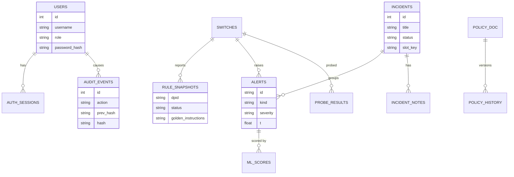

### 4.3 Why the design looks like this (answers to "why")
- Separate processes: Ryu runs on eventlet and FastAPI on asyncio; the Ryu loop must never block (ADR-002).
- Two Python versions: Ryu 4.34 needs Python 3.9 and old pinned tooling; the core runs on the system Python 3.10 (ADR-003, ADR-008).
- Spool before ZeroMQ: no silent alert loss (ADR-009).
- Table 0 critical, table 1 learning switch (ADR-006).
- HMAC rather than a public-key signature: a symmetric tag fits in 48 bits of a 64-bit cookie and is fast; the controller is both the signer and the verifier, so no one else needs to verify.

### 4.4 Core API (every route has a minimum role)
- Public: `GET /api/setup/status`, `POST /api/setup`, `POST /api/auth/login`, `GET /api/health`.
- Viewer: `GET /api/auth/me`, `POST /api/auth/logout`, `POST /api/auth/ws-ticket`, switches, rules and rules summary, alerts, incidents, events, probes, ML scores, policies, quarantine, sessions, reports summary and PDF, engine status, health detail.
- Analyst: acknowledge alerts, update incidents and add notes, audit log, policy history, CSV export, recording download.
- Admin: users, `PUT /api/policies`, start and stop recordings, `POST /api/engine/rotate-key`, `POST /api/rules/repair`, `POST /api/quarantine/release`, `GET /api/audit/verify`.
- Live stream: `WS /api/ws?ticket=`.
- OpenAPI docs at `/docs` and `/openapi.json` while the core runs.

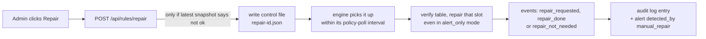

### 4.5 The twelve phases

```mermaid
flowchart LR
    P0["0 spike"] --> P1["1 engine L1"] --> P2["2 core"] --> P3["3 design system"] --> P4["4 pages + Live Detection"] --> P5["5 L2, L3, risk"]
    P5 --> P6["6 reports, replay"] --> P7["7 packaging, hardening"] --> P8["8 evaluation"] --> P9["9 rigorous testing"] --> P10["10 review"] --> P11["11 release gate"]
    classDef done fill:#2f7d4f,color:#fff,stroke:#1b4d30;
    classDef open fill:#b45f06,color:#fff,stroke:#6b3a04;
    class P0,P1,P2,P3,P4,P5,P6,P8,P10 done;
    class P7,P9,P11 open;
```

Green = done, orange = still in progress (9 of 12 done).

---

## Part 5. The website and the console

12 pages in the React website, grouped in the deck as Monitor, Analyze and Admin:
- Overview: patch panel (one port per signed rule, green when verified), KPI cards (protected rules, verified percent, open incidents, mean detect time), defense layers L1 to L3 with Active or Waiting, event feed, recent incidents.
- Topology: the engine, the switch and the hosts the learning switch has seen (MAC and port). Inter-switch links are not discovered (no LLDP) and the page says so.
- Rules: every signed rule with status (Verified, Altered, Shadow, Forged, Missing, Pending), the 8-band tag stripe, and a side-by-side diff of the signed version against what the switch holds. Admin Repair button. CSV export.
- Alerts and Incidents: list with severity, drill into what happened, why, what FlowGuard did, timeline.
- Live Detection (observation mode): remediation mode, engine counters, detections and the explanation. It runs nothing against the switch.
- Demo Lab: a simulated four-switch topology (S1 core, S2 edge-west, S3 edge-mid, S4 edge-east, six hosts). Buttons: change a rule, add an unknown rule, delete a rule, hide a rule, change and revert; then Repair now. Labelled Simulated.
- Probes (L2), ML (L3): results with reasons.
- Policy: dry run, weights, thresholds, action per severity, quarantined ports with Release, version history.
- Reports: totals from stored alerts only, CSV and PDF export, recorded sessions and in-browser replay at 1x to 100x.
- Audit: the hash-chained log with a tamper check.
- Settings: users and the HMAC key rotation button.
- Also: first-run setup and login screens, a Ctrl+K command palette, light and dark themes, reduced-motion support.

```mermaid
flowchart TD
    APP["App shell<br/>auth gate: /setup, /login"] --> MON["Monitor pages"]
    APP --> ANA["Analyze pages"]
    APP --> ADMG["Admin pages"]
    MON --> M1["Overview"]
    MON --> M2["Topology"]
    MON --> M3["Rules"]
    MON --> M4["Alerts and Incidents"]
    MON --> M5["Live Detection"]
    ANA --> A1["Probes L2"]
    ANA --> A2["ML L3"]
    ANA --> A3["Policy"]
    ANA --> A4["Demo Lab simulated"]
    ADMG --> D1["Reports"]
    ADMG --> D2["Audit"]
    ADMG --> D3["Settings"]
```

Design name: "Patch Panel" (PRODUCT.md). Truth rule: a card with no data says "No data yet"; a layer shows Active only when the API reports results; status is never colour alone (icon plus label). Contrast of every text token is unit-tested against WCAG AA in both themes.

Streamlit operator console: a second front end over the same core API. It signs in by itself on the local lab and mirrors Overview, Rules, Live Detection, Demo Lab, Alerts and Incidents, Topology, Policy, Reports, Audit, Engine, Users and L2/L3 pages. It has no automated UI test.

---

## Part 6. Results, tests and what they mean

### 6.1 Evaluation (`sudo make eval`, docs/results.md, run 2026-11-17, 115.5 s)
10 trials per tampering kind on the real lab (Open vSwitch, Mininet, real engine).

| Tampering | Detected | Engine detect median (ms) | Wall clock change to alert median (ms) | Restore median (ms) |
|---|---|---|---|---|
| forged | 10/10 | 15.9 | 23.5 | 3.9 |
| altered | 10/10 | 16.0 | 23.7 | 4.5 |
| missing | 10/10 | 15.9 | 23.4 | 12.1 |
| shadow | 10/10 | 15.9 | 22.7 | 12.8 |

- Legitimate policy churn: 0 false alerts over 10 install/retire cycles.
- Wall clock includes the `ovs-ofctl` process start and the 50 ms polling of the spool file used by the script, so it is an upper bound on what an operator notices. Engine detect (about 16 ms) is the engine's own clock.
- L2: 43 probe cycles, 9 with a failure; failures during the shadow and forged trials are expected because the tampering really changes forwarding.
- L3 on tampering alerts: 0.6 (only the "unsigned rule" feature fires; the baseline had too few normal changes).
- Load: a 303-rule policy applied and verified in 1.7 s; one changed rule under that load reported in 42.1 ms; no failed probe cycles.
- Soak (60 s): 9 policy-churn cycles, no false alerts, no failed pings, 19 probe cycles with none failing, engine memory flat at 51.7 MB.
- What it does not show: behaviour on real hardware, many switches, or an adversary who controls the host.

### 6.2 Test suites (QA_REPORT.md, 2026-11-17; core, engine and web re-run 2026-11-19)

| Suite | Result | What it covers |
|---|---|---|
| core tests (`pytest tests/unit tests/api`, venv 3.10) | 224 passed | crypto, canonical form, store, spool, policy, risk engine, L3, L2 planning, auth, roles on every route, CSRF, lockout, audit chain, ingest, quarantine API |
| engine tests (venv 3.9) | 145 passed | the pure engine modules under the Ryu interpreter |
| `make test-security` | 143 passed | authentication, roles, CSRF, validation, crypto, canonical form, Phase 5 logic |
| `make test-web` | 119 passed | components, contrast of every text token, formatting, tag stripe, Demo Lab model |
| `make test-e2e` | 10 passed | Playwright in Chromium: first run, sign in and lockout, palette, themes, Demo Lab, axe on all 12 pages in dark and light |
| `sudo make test-live` | 39 passed (4 min 49 s) | real Open vSwitch + Mininet + engine + core: forged, altered, deleted, shadow, tamper-and-revert; policy churn and key rotation without alerts; delivery incl. core restart; L2 probes; risk decision; policy changes repair behaviour; quarantine and release; 15 controller reconnects in 8 s with no alerts; wiped table repaired; changes made while the engine is down repaired after restart; 303-rule policy; 45-rule flood removed at the rate limit; two linked switches independent; engine and core as separate non-root accounts |

Line and branch coverage were not measured.

```mermaid
flowchart TB
    L["sudo make test-live: 39 tests<br/>real Open vSwitch + Mininet + engine + core"]
    E["make test-e2e: 10 browser tests, axe on 12 pages x 2 themes"]
    W["make test-web: 119 tests"]
    S["make test-security: 143 tests"]
    U["core 224 and engine 145: unit, property, API tests"]
    L --> E --> W --> S --> U
```

The pyramid reads top to bottom: slowest and most realistic at the top, fastest and most numerous at the bottom.

### 6.3 Reviews
`SECURITY_REVIEW.md` and `UX_REVIEW.md` are AI-simulated reviews (two independent AI reviewers). They are not a penetration test and no human review has happened. Findings fixed included: a host could forge the probe marker (now a random per-cycle nonce); quarantine could cut an attacker-chosen port; with dry run off an L1-only finding scored 0.45 and stopped repair (now floored at the restore threshold); logs under `/tmp` (moved to root-owned `/run/flowguard`); `flowguard export` copied password hashes (now exports operational tables only, never users, sessions, audit log, keys or the golden store).

### 6.4 Bugs the stress tests found (good "what did you learn" material)
- On connect the engine re-installed the signed policy before looking at the switch, silently overwriting rules changed while it was down. Fixed: audit first (`connect_audit`), then re-assert.
- A crash on a connection that died before the OpenFlow handshake (`bad dpid None`).
- As a non-root account `ovs-ofctl` could not create its control socket, so the monitor never started and detection silently fell back to the 2 s poll; fixed with `--unixctl=none`, and the test now requires monitor events.
- The engine's own signed re-installs after reconnects were sometimes reported as possible tamper-and-revert; fixed: an ADD with a signed cookie, table equal to golden, is not tampering.

---

## Part 7. How to open and run the project from WSL

Your machine already has WSL2 with Ubuntu-22.04, Open vSwitch running and the project set up. You normally only do steps 1 to 5.

```mermaid
flowchart TD
    A["1 PowerShell: wsl -d Ubuntu-22.04"] --> B["2 cd ~/flowguard"]
    B --> C["3 sudo bin/flowguard doctor<br/>all PASS?"]
    C --> D["4 sudo bin/flowguard start<br/>wait for 'FlowGuard prototype is running'"]
    D --> E["5 browser: open 127.0.0.1:8501 first<br/>then 127.0.0.1:8787, login admin / flowguard-demo"]
    E --> F["6 demo: Demo Lab page<br/>or second terminal ovs-ofctl add-flow"]
    F --> G["7 stop: Ctrl+C, or sudo bin/flowguard stop, then sudo mn -c"]
```

### Step 1. Open WSL
In Windows Terminal or PowerShell:

```powershell
wsl -d Ubuntu-22.04
```

You land in Linux as user `rkg`.

### Step 2. Go to the project

```bash
cd ~/flowguard
```

### Step 3. Check the environment (optional but good)

```bash
sudo bin/flowguard doctor
```

Every line should say PASS. If Open vSwitch is not running: `sudo systemctl restart openvswitch-switch`.

### Step 4. Start everything with one command

```bash
sudo bin/flowguard start
```

Optional: `sudo bin/flowguard start alert_only` makes the engine only report, and an admin repairs from the dashboard. The default `restore` repairs automatically. It builds the dashboard and the console environment the first time, then starts the Mininet lab, the Ryu engine, the core, the website and the Streamlit console. Wait for "FlowGuard prototype is running". Leave this terminal open; Ctrl+C stops everything.

| What | Address (open in your normal Windows browser) |
|---|---|
| Website (React, with Demo Lab) | http://127.0.0.1:8787 |
| Operator console (Streamlit) | http://127.0.0.1:8501 |

### Step 5. Sign in
Open the console first (http://127.0.0.1:8501). It creates the demo account the first time. Then sign in to the website with the demo account `admin` / `flowguard-demo`, or create your own admin on first visit. This account exists only on the local lab.

### Step 6. Show a real detection (second terminal)
Open a second WSL terminal. Look at the signed rules, then add one unsigned rule directly on the lab switch, which is exactly the tampering the project defends against:

```bash
sudo ovs-ofctl -O OpenFlow13 dump-flows s1 table=0
sudo ovs-ofctl -O OpenFlow13 add-flow s1 "table=0,priority=500,ip,nw_dst=10.0.0.4,actions=drop"
sudo ovs-ofctl -O OpenFlow13 dump-flows s1 table=0
```

Watch the Live Detection page: the rule appears as a detection within milliseconds and, in restore mode, is removed again; the second `dump-flows` will usually already show it gone. Only ever do this on your own lab switch `s1`.

### Step 7. Or use the guided demo

```bash
sudo make present
```

A terminal script tells you what to show and say at each step and makes the same switch changes the Phase 1 tests make (altered, forged, missing).

### Step 8. Stop

Ctrl+C in the terminal that ran `start`, or from anywhere:

```bash
sudo bin/flowguard stop
sudo mn -c
```

`sudo mn -c` cleans up leftover Mininet state after an interrupted run. Check what is running with `bin/flowguard status`. Logs are in `/run/flowguard/logs/stack.log` and `console.log`. `sudo bin/flowguard export` saves records of a run (never keys, users, sessions or the golden store).

### Starting from PowerShell without opening a Linux shell
`wsl -d Ubuntu-22.04 -u root -- bash -lc 'cd /home/rkg/flowguard && bin/flowguard start'` runs the same thing as root.

### Running the tests and measurements

```bash
make test                 # core, engine and web tests (no root)
make test-security        # security-focused tests (no root)
make test-e2e             # real browser tests with accessibility checks
sudo make test-live       # live tests on real Open vSwitch + Mininet (about 5 minutes)
sudo make eval            # detection and repair times, writes docs/results.md (about 2 minutes)
sudo make test-soak       # normal-operation soak, no false alerts expected
```

### First-time install on a fresh Ubuntu 22.04 or WSL2 (for reference)

```bash
sudo apt update && sudo apt install -y git curl
git clone https://github.com/RKG765/flowguard.git && cd flowguard
sudo bash scripts/setup_ubuntu.sh
sudo bin/flowguard doctor
```

`setup_ubuntu.sh` installs the apt packages, adds the deadsnakes PPA by hand with a fingerprint-checked key (Python 3.9 for Ryu), installs Node 20, starts the Open vSwitch daemons, creates `.venv-engine` (Python 3.9, Ryu 4.34 pins) and `.venv-core` (system Python 3.10, which sees the apt-installed Mininet), then runs the doctor. On WSL2 enable systemd first (`[boot] systemd=true` in `/etc/wsl.conf`, then `wsl --shutdown`).

```mermaid
flowchart TD
    SU["setup_ubuntu.sh"] --> AP["apt packages: OVS, Mininet, tools"]
    SU --> DS["deadsnakes PPA, key fingerprint checked<br/>Python 3.9"]
    SU --> ND["Node 20 from NodeSource"]
    SU --> OV["start Open vSwitch daemons"]
    SU --> VE[".venv-engine: Python 3.9, Ryu 4.34 pins"]
    SU --> VC[".venv-core: system Python 3.10, sees apt Mininet"]
    SU --> DR["run doctor: PASS / WARN / FAIL"]
    PR["prototype.sh on first start"] --> VU[".venv-ui with uv: Streamlit"]
    PR --> WB["npm ci and build web/dist"]
    PR --> SA["service-users.sh: create flowguard-engine and flowguard-core"]
    PR --> ST["tests/e2e_live/stack.py: lab + engine + core"]
```

### Troubleshooting

| Symptom | Fix |
|---|---|
| doctor says Open vSwitch is not running | `sudo systemctl restart openvswitch-switch` |
| `Missing .venv-core` or `.venv-engine` | re-run `sudo bash scripts/setup_ubuntu.sh` |
| console says "Engine has not reported yet" | an old core may hold port 8787: `sudo bin/flowguard stop`, then start again |
| port busy or a previous run stuck | `sudo bin/flowguard stop; sudo mn -c`, then start again |
| website needs a login you do not have | open the console first, it creates `admin` / `flowguard-demo` |

---

## Part 8. What every file contains

Repository root `/home/rkg/flowguard`.

### 8.1 Top-level files

| File | Contains |
|---|---|
| `README.md` | what it does, install, commands, documentation index |
| `RUN_AND_SHOW.md` | fresh-laptop steps, the 8-minute demo script, proof commands, troubleshooting |
| `STATUS.md` | generated phase table (12 phases, 9 done), progress graph, verification date |
| `ROADMAP.md`, `HANDOFF.md` | what comes next; how to resume work |
| `CLAUDE.md` | working rules for the AI assistant that helped build it |
| `PRODUCT.md` | product purpose, users, principles of the Patch Panel design |
| `DECISIONS.md` | ADR-001 to ADR-023, every design decision with context and consequences |
| `ARCHITECTURE.md` | components and their status, system diagram, alert path sequence, API table, data model |
| `TESTING.md`, `QA_REPORT.md` | test strategy; the full QA run, issues found and fixed |
| `SECURITY_REVIEW.md`, `UX_REVIEW.md` | AI-simulated reviews and fixes |
| `RELEASE_CHECKLIST.md` | every release item with its evidence, open items unchecked |
| `CHANGELOG.md` | change history |
| `Makefile` | all `make` targets (test, test-live, eval, start, present, stop and so on) |
| `config.example.yaml` | configuration template: ports, key path, engine settings (critical tables, verify mode, grace window, rate limit, rotation grace, response mode, policy path), spool limits, risk defaults |
| `bin/flowguard` | the command line: doctor, keygen, start, stop, status, export (standard library only) |
| `requirements/` | pinned dependency lists (engine lock file, core, ui) |

### 8.2 `engine/` (Ryu app and pure modules, runs under Python 3.9)

| File | Contains |
|---|---|
| `app.py` (930 lines) | the Ryu application `FlowGuardEngine`: connect handling and `connect_audit`, `install_signed_rule`, `retire_rule`, policy watcher, the supervised monitor loop, `schedule_pass` and verification passes, `_handle_finding` (restore, delete, quarantine), reconcile loop, manual repair and port release requests, key rotation, L2 probe loop (`_probe_switch`, `_probe_packet`, `_probe_stats_done`), status and snapshot publishing |
| `canonical.py` | canonical rule form, field normalization, `RuleSpec`, `CanonicalError`, overlap test `matches_overlap` |
| `crypto.py` | key loading and checks, `Signer`, HMAC cookie build and verify, epochs, rotation grace, `generate_key_file` |
| `verifier.py` | `classify()` returning findings (ok, missing, altered, shadow, forged), `Pending` attribution set |
| `responder.py` | `Responder` plans restore or delete, `RateLimiter` |
| `risk.py` | `RiskPolicy`, fused score, severity, action, dry run and safety rules |
| `prober.py` | L2 probe planning and judging, supported fields, probe marker |
| `anomaly.py` | L3 `AnomalyScorer`: robust z-score, squash, noisy-OR, learn, score, save and load |
| `store.py` | golden store (SQLite), `StoreCorrupt` |
| `spool.py` | `AlertSpool`: append with fsync, rotation, acknowledgement, torn-line healing |
| `channel.py` | non-blocking ZeroMQ PUSH publisher with a bounded queue |
| `monitor_parser.py` | parses `ovs-ofctl monitor` text into events |
| `ryu_codec.py` | translate between `RuleSpec` and Ryu OpenFlow 1.3 objects |
| `policy.py` | policy file loader, diff, reserved priority 65000 |
| `config.py` | engine settings: defaults, YAML file, environment overrides |
| `policies/lab_default.yaml` | the three signed lab rules |

```mermaid
flowchart LR
    CAN["canonical.py"] --> CRY["crypto.py"]
    CAN --> STO["store.py"]
    CAN --> VER["verifier.py"]
    CRY --> VER
    STO --> VER
    VER --> RES["responder.py"]
    VER --> RSK["risk.py"]
    PRB["prober.py"] --> RSK
    ANO["anomaly.py"] --> RSK
    MON["monitor_parser.py"] --> APP["app.py<br/>Ryu glue"]
    RES --> APP
    RSK --> APP
    COD["ryu_codec.py"] --> APP
    POL["policy.py"] --> APP
    SPO["spool.py"] --> APP
    CHA["channel.py"] --> APP
```

### 8.3 `core/` (FastAPI service, Python 3.10)

| File | Contains |
|---|---|
| `main.py` | app factory (`core.main:create_app`), security headers, startup, serves `web/dist` |
| `models.py` | SQLAlchemy tables listed in 4.2 |
| `db.py`, `migrations/` | SQLite WAL engine, Alembic migration `0001_initial_schema` |
| `deps.py` | request dependencies: DB session, authenticated principal, role check, CSRF, audit helper |
| `security.py` | argon2id hashing, session tokens, login rate limiting, password policy |
| `audit.py` | hash-chained audit log and `verify_chain` |
| `hub.py` | WebSocket fan-out hub, bounded queue per client, one-time tickets |
| `ingest.py` | ingests engine records (idempotent), groups alerts into incidents, stores snapshots |
| `ipc/receiver.py` | ZeroMQ PULL receiver thread and ordered spool tail with acknowledgement |
| `api/auth.py` | setup, login, logout, current user, WebSocket ticket, users |
| `api/data.py` | read APIs (switches, rules, alerts, incidents, events, probes, ML scores) and analyst actions |
| `api/admin_api.py` | policies, recordings, reports (summary, CSV, PDF), audit, engine control, health, quarantine release |
| `pdf.py` | small dependency-free PDF writer and report layout |
| `config.py` | core settings |

### 8.4 `web/` (React 18 + TypeScript + Vite + Tailwind)

| Path | Contains |
|---|---|
| `src/App.tsx`, `main.tsx` | routes and bootstrap |
| `src/pages/` | Overview, Rules, Alerts, Topology, LiveDetection, Demo, Admin (Probes, ML, Policy, Reports, Audit, Settings), AuthScreen, Replay, DesignGallery, Planned |
| `src/components/` | layout (AppShell, CommandPalette, nav), rules (RuleDiff, RepairButton), alerts (AlertExplain), ui (Patch panel, Kpi, ConfirmDialog, primitives) |
| `src/lib/` | `api.ts` REST client, `auth.ts`, `live.ts` WebSocket feed, `demo.ts` Demo Lab model, `replay.ts`, `format.ts`, `types.ts`, `prefs.ts` theme and motion, `contrast.ts` |
| `src/styles/` | `tokens.css` design tokens (light and dark), `index.css`, contrast test |
| `e2e/`, `e2e-live/` | Playwright specs (throw-away core; throw-away lab) |
| `shots.mjs` | screenshot script added for the presentation (not part of the product) |

### 8.5 Other folders

| Path | Contains |
|---|---|
| `ui/streamlit_app.py` | the Streamlit operator console (645 lines) |
| `topo/topo_basic.py` | the Mininet lab: one OVS switch, four hosts, optional second switch, explicit dpids |
| `scripts/` | `setup_ubuntu.sh`, `doctor.py`, `prototype.sh` (the one-command start), `demo.sh`, `present.py` (guided demo), `eval.py` (evaluation and soak), `service-users.sh` (creates the two unprivileged accounts), `pristine-check.sh` (clean-install check), `update_docs.py` (regenerates doc tables), `spike/` (Phase 0 feasibility experiments) |
| `tests/unit` | canonical, crypto, verifier, store/spool/policy, phase 5 logic, PDF, doctor, docs tool |
| `tests/api` | auth, roles on every route, ingest, admin features |
| `tests/engine` | Ryu codec, channel and config (real Ryu and ZeroMQ) |
| `tests/integration` | live tests: l1, l2, phase5, core, least privilege, multi-switch, resilience |
| `tests/e2e_live/stack.py` | starts a throw-away lab + engine + core (also used by `prototype.sh`) |
| `docs/` | `results.md`, `threat_model.md`, `spike_findings.md`, `design.md`, `IMPLEMENTATION_PLAN.md`, `graphs/` (mermaid), `img/` (screenshots), `spike_evidence/` (raw measurements) |
| `results/` | `eval.json`, `load.json`, `soak.json`, test outputs |
| `attacks/`, `helper/` | descoped by ADR-019; planned only |

Phases 0 to 11: 0 environment and feasibility spike, 1 engine L1, 2 core service, 3 design system, 4 core pages and Live Detection, 5 L2, L3, risk engine, 6 remaining pages and reports, 7 packaging and hardening, 8 evaluation and docs, 9 rigorous testing, 10 persona-based review, 11 fix loop and release gate. Done: 0 to 6, 8 and 10. Still in progress: 7, 9, 11.

---

## Part 9. Literature, gap and novelty (with links)

All links were opened in Chrome and the page matched the paper.

| # | Paper | What to say about it | Link |
|---|---|---|---|
| 1 | McKeown et al., OpenFlow: Enabling Innovation in Campus Networks, SIGCOMM CCR 2008 | defines the flow table we protect | https://dl.acm.org/doi/10.1145/1355734.1355746 |
| 2 | Pfaff et al., The Design and Implementation of Open vSwitch, NSDI 2015 | our switch | https://www.usenix.org/conference/nsdi15/technical-sessions/presentation/pfaff |
| 3 | Lantz, Heller, McKeown, A Network in a Laptop (Mininet), HotNets 2010 | our lab | https://dl.acm.org/doi/10.1145/1868447.1868466 |
| 4 | Khurshid et al., VeriFlow, NSDI 2013 | verifies updates the controller sends; cannot see a rule added on the switch | https://www.usenix.org/conference/nsdi13/technical-sessions/presentation/khurshid |
| 5 | Kazemian, Varghese, McKeown, Header Space Analysis, NSDI 2012 | static check of configured rules | https://www.usenix.org/conference/nsdi12/technical-sessions/presentation/kazemian |
| 6 | Porras et al., A Security Enforcement Kernel for OpenFlow Networks (FortNOX), HotSDN 2012 | conflict checks and authorization inside the controller | https://people.engr.tamu.edu/guofei/paper/FortNOX-HotSDN12.pdf |
| 7 | Hessam, Saba, Alkhayat, A new approach for detecting violation of data plane integrity in SDN, J. Computer Security 2021 | closest work: digest of each flow entry in the cookie plus a table digest | https://journals.sagepub.com/doi/10.3233/JCS-200094 |
| 8 | Vyas, Shyamasundar, SecSDN, SECRYPT 2021 | table hash on the controller plus trusted monitor code on the switch | https://doi.org/10.5220/0010575505870594 |
| 9 | Dhawan et al., SPHINX, NDSS 2015 | flow-graph anomaly detection | https://www.ndss-symposium.org/ndss2015/ndss-2015-programme/sphinx-detecting-security-attacks-software-defined-networks/ |
| 10 | Xiao et al., D2C2: Unexpected Data Dependency Creation and Chaining, IEEE S&P 2020 | a weak attacker at one host or switch can reach control-plane logic | https://ieeexplore.ieee.org/document/9152642 |
| 11 | Chao et al., Securing Data Planes in SDN, IEEE NetSoft 2016 | test packets localise switches that disobey rules | https://www.csie.ntu.edu.tw/~hchsiao/pub/2016_IEEE_SecVirtNet.pdf |
| 12 | Ke, Hsiao, Kim, SDNProbe, ICDCS 2018 | active probing finds faulty switches | https://dblp.dagstuhl.de/rec/conf/icdcs/KeHK18.html |
| 13 | Zhang et al., FOCES, ICDCS 2018 | flow-counter conservation across the network | https://doi.org/10.1109/ICDCS.2018.00085 |
| 14 | Kamisinski, Fung, FlowMon, SafeConfig 2015 | switch statistics reveal dropping and swapping | https://doi.org/10.1145/2809826.2809833 |
| 15 | Krawczyk, Bellare, Canetti, HMAC, RFC 2104, 1997 | the keyed MAC in the cookie | https://datatracker.ietf.org/doc/html/rfc2104 |

Websites used for tools: Open vSwitch https://www.openvswitch.org/ and https://docs.openvswitch.org/en/latest/, Ryu https://ryu-sdn.org/, Mininet http://mininet.org/, OpenFlow 1.3 spec https://opennetworking.org/wp-content/uploads/2014/10/openflow-spec-v1.3.0.pdf, FastAPI https://fastapi.tiangolo.com/, React https://react.dev/, Streamlit https://streamlit.io/, ZeroMQ https://zeromq.org/, SQLite WAL https://www.sqlite.org/wal.html, Argon2 RFC 9106 https://datatracker.ietf.org/doc/html/rfc9106, Playwright https://playwright.dev/.

```mermaid
flowchart TD
    subgraph BASE["Base and platform"]
        R1["1 OpenFlow"]
        R2["2 Open vSwitch"]
        R3["3 Mininet"]
    end
    subgraph VER["Verify the intended configuration"]
        R4["4 VeriFlow"]
        R5["5 Header Space Analysis"]
    end
    subgraph INT["Rule integrity and controller security"]
        R6["6 FortNOX"]
        R7["7 Hessam: digest in cookie"]
        R8["8 SecSDN: table hash"]
        R10["10 D2C2: weak attacker"]
    end
    subgraph PRO["Probing and statistics"]
        R9["9 SPHINX"]
        R11["11 Chao: test packets"]
        R12["12 SDNProbe"]
        R13["13 FOCES"]
        R14["14 FlowMon"]
    end
    R15["15 HMAC RFC 2104"]
    FG["FlowGuard"]
    BASE --> FG
    VER -->|"gap: not what the switch holds"| FG
    INT -->|"closest: 7 and 8"| FG
    PRO -->|"L2 and L3 evidence"| FG
    R15 -->|"keyed tag"| FG
```

Honest points about the literature:
- Paper 7 already puts a digest per flow entry in the cookie field. Do not claim "using the cookie" as the novelty.
- The gap descriptions follow each paper's abstract or title; read the full text of papers 6, 7 and 8 before the viva, because those are the ones the professor is most likely to challenge.

### Novelty, stated carefully
Judged against the papers above (not a claim over all prior work), FlowGuard goes further in five ways:
1. A keyed HMAC-SHA256 tag bound to the switch id and key epoch, so a copied or replayed rule fails on another switch or after rotation.
2. Event-driven detection through the Open vSwitch flow monitor: 30 of 30 quick reverts caught, polling 0 of 30.
3. L2 canary probes that catch a switch that lies about its table.
4. One risk engine that fuses L1, L2 and L3 under an editable policy; machine learning alone never repairs; optional port quarantine.
5. Automatic repair, measured on real Open vSwitch: 40 of 40 detected, about 23 ms to alert.

---

## Part 10. Limitations: say these before the professor does

- Verified on WSL2 Ubuntu 22.04 only. Native Ubuntu, real hardware and more than two switches are untested. SQLite corruption is untested.
- In the lab the controller, key and switch share one host, so root on that host defeats the product. A real deployment keeps the key off the switches.
- No TLS on the OpenFlow channel is claimed. The ZeroMQ socket is protected by file permissions (group `flowguard`) only.
- L3 is a statistical baseline, not a neural network, and slow drift can evade it.
- L2 probes only cover IPv4/IPv6 TCP/UDP, ICMPv4, ARP and exact or masked matches. A switch that fakes counters and PacketIn is out of scope.
- Wall-clock timings include script overhead, so they are upper bounds. They come from one switch in a lab.
- The security and UX reviews were AI-simulated. No human review has happened.
- The repair rate limit (30 per minute per switch) deliberately slows removal of a flood.
- Tables other than the critical table 0 are not verified.
- The audit chain does not protect against someone who can rewrite the whole database file.

---

## Part 11. Questions the professor may ask, with answers

### Basics
1. What is the problem you solve? The controller cannot prove that every rule in a switch's flow table is one it installed. Anyone with switch access can add, change or delete rules with one command and the controller never learns.
2. Why is this a real problem and not theory? In SDN the flow table is the enforcement point of the security policy (ACLs). A silently changed rule silently changes security. The spike showed even a periodic check misses a quick change-and-revert.
3. What is SDN? A network where a central controller decides forwarding policy and switches just apply the rules they are given over OpenFlow.
4. What is a flow rule? Match, priority, instructions, cookie, counters, timeouts. Higher priority wins; empty instructions mean drop.
5. What is a cookie field? A 64-bit opaque value the controller attaches to a rule; the switch stores it and ignores it. We store the signature in it.
6. What is OpenFlow? The protocol between controller and switch. We use version 1.3.
7. What are Ryu, Open vSwitch and Mininet? Ryu: Python controller framework. OVS: a real software OpenFlow switch. Mininet: builds a virtual network of hosts and switches on one machine.
8. Why two tables? Table 0 holds the signed security rules (critical table); table 1 is an ordinary learning switch. Packets that match no ACL rule go to table 1.
9. What is a dpid and why do you set it explicitly? The switch's identity. The signature binds the dpid, so a valid cookie cannot be reused on another switch.

### Detection
10. How do you detect tampering? Every rule carries an HMAC tag. On every change event the engine reads the table, recomputes and compares against the signed golden store, and classifies each rule.
11. What kinds of tampering do you detect? Forged, altered, missing, shadow, and tamper-and-revert (reported as unattributed change).
12. Is detection triggered by polling? No. The OVS flow monitor pushes an event for every change. A 5 s reconcile poll is only a safety net.
13. Why does the monitor use OpenFlow 1.0? This OVS (2.17) rejects the standard OpenFlow 1.4 monitor and the Nicira monitor over OpenFlow 1.3, but accepts the Nicira monitor over an OpenFlow 1.0 session. Evidence is in `docs/spike_findings.md`.
14. Why confirm with a stats request after the event? Events do not carry priority or instructions. The stats reply is the ground truth.
15. What if the attacker reverts before your stats request? The table then equals the signed rules. The verifier therefore also raises `unattributed_change` for any critical-table event the engine's own FlowMods do not explain.
16. What is a shadow rule? An unsigned rule at equal or higher priority that overlaps a signed rule and takes its traffic. It is sneaky because the signed rule still looks present and ok.
17. How do you avoid alerting on your own changes? The `Pending` set attributes the engine's own FlowMods and skips those slots for a 500 ms grace window. It skips by slot, not cookie, so a copied cookie cannot hide.
18. How fast is detection? Engine-side median about 16 ms; about 23 ms wall clock from change to alert; repair 4 to 13 ms median.
19. How many false alerts? 0 over 10 policy-change cycles, and 0 in the 60 s soak. A small sample, stated as such.

### Cryptography
20. Why HMAC and not a digital signature? One party (the controller) both signs and verifies, so a symmetric MAC is enough, and the tag must fit in a few bytes of a 64-bit cookie. A public-key signature is far too large.
21. Why only 48 bits? 16 of the 64 cookie bits carry the epoch. Forging needs about 2^47 expected online guesses against a verifier that restores on first sight; the realistic attack is copying or replaying, which the binding addresses.
22. What does the tag cover? dpid, epoch, table, priority, normalized match, normalized instructions. Not counters, timeouts, flags or the cookie itself.
23. What stops copying a valid cookie onto another rule? The tag covers priority, match and instructions, so on a different rule it fails verification and the rule is classified forged.
24. What if an old signed rule is replayed after key rotation? The epoch is in the signed bytes; the old epoch is accepted only for 300 s after rotation, then rejected, and `signature_valid` shows it was a valid old signature.
25. Where is the key kept? A file outside the repo, mode 0600, owned by the engine user (or an environment variable). The engine refuses to start otherwise. The core cannot read it.
26. What is key rotation? Starting a new epoch; each epoch derives its own key from the master key.

### L2, L3, risk
27. Why do you need L2 if L1 verifies every rule? L1 trusts what the switch reports. A lying switch, or a rule listed but not acting, passes L1.
28. How does an L2 probe work? PacketOut a tagged packet to the pipeline that the policy says must hit a rule; check that rule's counter rose and that a packet meant to be dropped did not return.
29. Can a host fake probe results? Each cycle has a random nonce in the payload and a returning probe only counts in that cycle, so forged or replayed markers do not count (found and fixed in the security review).
30. Is L3 machine learning? It is statistical learning: a robust baseline with median and MAD, not a neural network. It is explainable and needs no extra libraries.
31. What does L3 catch that L1 cannot? A correctly signed rule that behaves unlike normal churn (threat T7), for example a signed drop at a very high priority.
32. How are the layers combined? Weighted mean with weights 1.0, 0.8, 0.4 and thresholds 0.3, 0.5, 0.8, under an editable policy. A failed signature never scores below the restore threshold and ML alone never repairs.
33. Why must ML never repair alone? It is probabilistic; a false positive would delete a legitimate rule.
34. What is dry run? The risk engine records what it would do but the engine does nothing. The default policy has dry run on.
35. What is quarantine? Dropping all traffic on one port with a reserved-priority rule (65000 and above), optional and off by default; an admin can release it.

### System and design
36. Why separate engine and core processes? Ryu runs on eventlet, FastAPI on asyncio, and the engine loop must never block on the core.
37. How can you promise no alert is lost? Spool first with fsync, then ZeroMQ; the core acknowledges in order from the spool; unacknowledged records replay after a restart. Tested by restarting the core.
38. What happens if the core is down? Alerts stay in the spool; they are stored after restart (tested live).
39. What is the golden store? The engine's SQLite database of the signed rules every switch should hold.
40. What is the Demo Lab? A labelled in-browser simulation of a four-switch network. It sends nothing to any switch. It lets you show detection and repair on a projector without touching a switch.
41. Does your product attack anything? No (ADR-019). It observes, detects and repairs. Tampering in the demo is a plain `ovs-ofctl` command on the lab's own switch.
42. Why two front ends? The React website is the main one; the Streamlit console is a quick operator view over the same API.
43. How is the website secured? argon2id, HttpOnly SameSite cookies, CSRF token, roles on every route, lockout, one-time WebSocket tickets, strict CSP, hash-chained audit.
44. What does least privilege mean here? The engine and the core run as separate unprivileged accounts; the key is readable by the engine only, the user database by the core only; only the lab is root.
45. What is the audit log and its limit? Each row hashes the previous one, so editing a row in place is detectable; rewriting the whole database file is not.

### Evaluation
46. How did you evaluate? Ten trials per tampering kind on a real OVS + Mininet lab with the real engine; measured detection and repair times; 10 install/retire cycles for false alerts; a 303-rule load test; a soak run.
47. What do the numbers not show? Real hardware, many switches, an adversary who controls the host. One switch, WSL2, wall clock includes script overhead.
48. Why is wall clock larger than engine time? It includes starting `ovs-ofctl` and a 50 ms spool-file poll in the measurement script.
49. How many tests do you have? 224 core, 145 engine, 143 security, 119 web, 10 browser, 39 live; all passing. Coverage was not measured.
50. What bugs did testing find? Silent overwrite of rules changed while the engine was down, a crash before the handshake, the monitor not starting as non-root, and own re-installs misreported as tamper-and-revert. All fixed with regression tests.

### Novelty and literature
51. What is new? The combination, judged against the reviewed papers: keyed tag bound to switch and epoch, event-driven detection, probes for a lying switch, one policy-driven risk engine and automatic repair, measured on a real switch.
52. How is it different from VeriFlow and Header Space Analysis? They verify the configuration the controller sends or analyse it statically. FlowGuard checks what the switch actually holds, live.
53. How is it different from Hessam et al.? They also put a digest in the cookie and a table digest and locate compromised switches. We use a keyed HMAC bound to switch and epoch, an event-driven monitor, L2 probes, L3, a risk engine and automatic repair. Read their paper fully before the viva.
54. How is it different from SecSDN? It keeps a hash on the controller and needs trusted monitoring code on the switch; our switch stays unmodified.
55. How is it different from SPHINX, FOCES, FlowMon, SDNProbe? They detect that a switch misbehaves statistically or by probing; they do not give per-rule proof of who wrote a rule. We use probing as L2 and statistics as L3, with L1 as the proof.
56. Why did you cite FortNOX? It protects the controller (rule conflicts, authorization) but does not verify the switch table.

### Limits and future
57. What are the limits? See Part 10. Lead with: lab on one host, WSL2 only, one switch measured, L3 is not a neural network.
58. What if the controller or the key is compromised? Out of scope; L1 is bypassed. L3 is the only layer aimed at valid but malicious rules.
59. What next? Key and controller on a separate host, TLS on the OpenFlow channel, native Ubuntu and hardware tests, more than two switches, human security review.
60. Why not stop attacks instead of detecting? FlowGuard cannot stop someone with switch access from issuing a command. It makes tampering visible and reversible within milliseconds.

### Hard follow-ups (the second question a sharp professor asks)
61. "You said event-driven. What if the monitor session dies?" The supervisor restarts it with backoff and raises `monitor_down`; the 5 s reconcile poll keeps verifying meanwhile. A revert faster than 5 s during that gap would be missed.
62. "A 48-bit tag is short. Can I brute force it?" Offline you cannot, because you need the key to compute it. Online you must guess against a verifier that restores on first sight; expected 2^47 guesses. The easier attack is copying a valid cookie, which fails because the tag covers the rule's fields and the switch id.
63. "Your engine restores rules automatically. What if I make it fight me?" The restore rate limit (30 per switch per minute) turns further repairs into alerts, so it cannot be driven into an endless loop.
64. "What if the attacker adds the rule while the engine is restarting?" On connect the engine audits the switch table against the signed store first (`connect_audit`) and only then re-applies the policy, so changes made while it was down are reported and repaired. Tested live.
65. "Where could your system give a false alarm?" Legitimate policy edits are signed churn and raise nothing (tested). The L3 baseline can flag unusual but legitimate bursts, which is why ML alone never repairs.
66. "How do you know the L2 probe is not itself an attack?" It only exercises the lab's own signed rules, carries a marker and nonce, and a forward rule's probe may reach a host port with nothing but the marker as payload.
67. "Prove the monitor result is not luck." The spike used 30 trials per scenario with raw JSON evidence in `docs/spike_evidence/`. The result is 30/30 against 0/30, from one tamper pattern, so it shows polling can miss fast reverts, not a detection probability curve.
68. "Why Python 3.9 for the engine and 3.10 for the core?" Ryu 4.34 only installs and runs with old pinned tooling on 3.9; the core uses the system Python 3.10 which also sees the apt-installed Mininet.

---

## Part 12. Self-test (cover the answers and try)

Read the question, answer aloud, then open the answer.

<details><summary>1. Say the whole project in three sentences.</summary>
The controller cannot prove that every rule in a switch table is one it installed. FlowGuard signs every controller rule with an HMAC tag in the cookie, watches the switch with the OVS flow monitor, compares the live table with the signed copy and restores tampered rules in milliseconds. L2 probes and an L3 anomaly score add evidence, and a risk engine decides under an editable policy.
</details>

<details><summary>2. What are the five finding kinds?</summary>
ok, forged, altered, shadow, missing; plus unattributed change for tamper-and-revert.
</details>

<details><summary>3. Draw the cookie.</summary>
64 bits: the upper 48 bits are the tag (first 48 bits of HMAC-SHA256 over the canonical rule bytes with the epoch key), the lower 16 bits are the key epoch.
</details>

<details><summary>4. What does the tag cover and what does it leave out?</summary>
Covers dpid, epoch, table, priority, normalized match and instructions. Leaves out counters, durations, timeouts, flags and the cookie itself.
</details>

<details><summary>5. Why did the spike pick the OpenFlow 1.0 monitor?</summary>
OVS 2.17 rejects the standard OF1.4 flow monitor and the Nicira monitor over OF1.3. The Nicira NXST_FLOW_MONITOR works over an OF1.0 session on a passive port.
</details>

<details><summary>6. Polling versus monitor numbers?</summary>
Quick tamper-and-revert: monitor 30/30, polling every 0.5 s 0/30 (kernel datapath); userspace 10/10 against 0/10.
</details>

<details><summary>7. How are L1, L2 and L3 combined?</summary>
Weighted mean (1.0, 0.8, 0.4) against thresholds 0.3, 0.5, 0.8; failed signature floored at the restore threshold; ML alone capped at alert_only; dry run records only.
</details>

<details><summary>8. What is the L3 score of an unsigned rule while the baseline is still learning?</summary>
0.6, with the reason "the rule is not signed by the controller" and a note that the baseline is still learning (fewer than 8 samples).
</details>

<details><summary>9. What is the grace window and why by slot?</summary>
500 ms during which the engine's own FlowMods are not judged. By slot because exempting by cookie let an attacker copy a signed cookie onto another rule and hide inside the window.
</details>

<details><summary>10. How does the system make sure no alert is lost?</summary>
fsync to the spool first, then ZeroMQ; the core tails the spool in order and acknowledges the highest in-order sequence; records are idempotent; overflow is counted and raised as spool_overflow.
</details>

<details><summary>11. Who can do what in the core?</summary>
viewer reads data and the live stream; analyst also acknowledges alerts, adds notes, reads the audit log and exports; admin also manages users and policy, repairs, releases ports, rotates the key and verifies the audit chain.
</details>

<details><summary>12. What did the real run on 2026-11-19 show?</summary>
An unsigned priority-500 drop rule added to s1 was classified shadow, severity high, L3 0.60, detected in 16.3 ms, repair confirmed 0.7 ms after detection, the table back to three signed rules within 4 seconds.
</details>

<details><summary>13. State the evaluation result in one line.</summary>
40 of 40 tamperings detected on real Open vSwitch, about 23 ms wall clock (16 ms engine), restores 4 to 13 ms, 0 false alerts in 10 policy-change cycles.
</details>

<details><summary>14. Name three limitations.</summary>
Lab on one host (root there defeats it), WSL2 and one switch measured only, L3 is a statistical baseline and not a neural network.
</details>

<details><summary>15. What is the closest related paper and how do you differ?</summary>
Hessam et al. (J. Computer Security 2021): digest per flow entry in the cookie plus a table digest. FlowGuard adds a keyed HMAC bound to switch and epoch, an event-driven monitor, L2 probes, L3, a risk engine and automatic repair.
</details>

<details><summary>16. Which command starts the project and which addresses do you open?</summary>
`sudo bin/flowguard start` in `~/flowguard` inside WSL; open http://127.0.0.1:8501 first, then http://127.0.0.1:8787 and sign in as admin / flowguard-demo.
</details>

<details><summary>17. Which command cleans up after a stuck run?</summary>
`sudo bin/flowguard stop` then `sudo mn -c`.
</details>

<details><summary>18. Which port does what?</summary>
8787 website and API, 8501 Streamlit console, 5173 Vite dev server, 6653 OpenFlow controller port, 6634 OVS monitor port for s1.
</details>

<details><summary>19. Why is the Demo Lab not an attack tool?</summary>
It is a labelled simulation inside the browser that sends nothing to any switch. The product executes no attacks (ADR-019).
</details>

<details><summary>20. What does the audit chain prove and not prove?</summary>
It proves a row was not edited or removed in place (each row hashes the previous). It does not prove the file is authentic, because someone who can write the database can rewrite the whole chain.
</details>

<details><summary>21. What are the three Python environments?</summary>
`.venv-engine` Python 3.9 with Ryu 4.34, `.venv-core` Python 3.10 for the lab, core and tests, `.venv-ui` for Streamlit.
</details>

<details><summary>22. What does the risk engine do with an L1-only finding?</summary>
Score 1.0 / 2.2 = 0.45, but the code floors a failed signature at the restore threshold (0.5), so automatic repair still happens when dry run is off.
</details>

<details><summary>23. What is quarantine and what protects it from abuse?</summary>
A rule dropping everything from one port, at reserved priority 65000 or above. Only a rule found on the switch can name the port, never a missing signed rule; it is off by default and an admin releases it.
</details>

<details><summary>24. What bugs did the stress tests find?</summary>
Overwrite of rules changed while the engine was down, crash before the OpenFlow handshake, monitor not starting as non-root, own re-installs reported as tamper-and-revert.
</details>

<details><summary>25. What will you say if asked "is this machine learning"?</summary>
L3 is statistical learning, a robust baseline using median and MAD with noisy-OR, not a trained neural network; it is explainable and never repairs on its own.
</details>

---

## Part 13. Slide by slide: what they may ask

This matches the 30-slide deck `FlowGuard-v6.pptx`.

| Slide | Title | Likely question | Where the answer is |
|---|---|---|---|
| 1 | Title | what does the name mean | Part 0 |
| 2 | Topics | what are the main parts | Parts 2 to 6 |
| 3 | Is the switch still enforcing the policy? | what do you mean by enforcing | 1.1, 1.3 |
| 4 | The problem | give a concrete example | 2.1, Part 3 real run |
| 5 | Why it matters | where does 0 of 30 come from | 1.10 |
| 6 | Objectives | which objective is hardest | 1.12 to 1.14 |
| 7 | Threat model | what is out of scope | 2.4 |
| 8 | Literature: SDN base and verification | how is VeriFlow different | Q52 |
| 9 | Literature: integrity and controller security | how is Hessam different | Q53 |
| 10 | Literature: probing, statistics, keyed tags | why HMAC, why probing | Q20, Q27 |
| 11 | Research gaps | prove the gap | Part 9 honesty notes |
| 12 | Our novelty | is the cookie idea new | Part 9 |
| 13 | System architecture | why separate processes | 4.3 |
| 14 | Website: pages and API | which role can repair | 4.4, 1.17 |
| 15 | Detection workflow | what happens if monitor dies | Q61 |
| 16 | Technology choices | why Ryu 4.34 on Python 3.9 | Q68 |
| 17 | Topology and tables | why two tables, what are the three rules | 1.4 |
| 18 | Website: overview | what is mean detect time | 6.1 |
| 19 | Website: rules | what is the tag stripe | Part 5 |
| 20 | Website: a real detection | explain the timeline | Part 3 real run |
| 21 | Website: Demo Lab | is it real | Q40, Q41 |
| 22 | Probes, ML, policy, reports | what is shown on each | Part 5 |
| 23 | Operator console | why a second front end | Q42 |
| 24 | Results | why 23 ms and 16 ms | Q18, Q48 |
| 25 | Testing | what does 39 live tests cover | 6.2 |
| 26 | Limitations | what would you do next | Part 10, Q59 |
| 27 | Status and next steps | which phases are open | 4.5 |
| 28 | Conclusion | one-line takeaway | Part 0 |
| 29 | Sources: websites | which tool did you take from where | Part 9 |
| 30 | Thank you and paper links | open a link | Part 9 table |

---

## Part 14. Glossary A to Z

- ACL: access control list, rules that allow or drop traffic. Table 0 holds them.
- Alembic: database migration tool.
- Alert: one detection record (kind, severity, rule, timings, risk decision).
- argon2id: password hashing function.
- Audit log: hash-chained record of every state change and every denial.
- Baseline: the L3 model of normal rule churn.
- Canonical form: deterministic byte form of a rule used for signing.
- Canary probe: a tagged test packet used by L2.
- Cookie: 64-bit field in a flow rule that carries the tag and epoch.
- Core: the FastAPI service that stores and serves data.
- CSRF: cross-site request forgery; blocked by a per-session token header.
- Critical table: the table FlowGuard protects (table 0).
- Datapath: how OVS forwards packets, kernel or userspace.
- dpid: switch identity.
- Dry run: record what would happen, do nothing.
- Engine: the Ryu application.
- Epoch: key generation number (16 bits in the cookie).
- fsync: force data to disk.
- Golden store: signed rules each switch should hold.
- Grace window: 500 ms during which the engine's own FlowMods are not judged.
- HMAC-SHA256: keyed hash used for the tag.
- Incident: alerts grouped by switch and rule slot within a window.
- Least privilege: each process has only the access it needs.
- MAD: median absolute deviation, used for robust z-scores.
- Match: which packets a rule applies to.
- Monitor (flow monitor): OVS feature that pushes an event for each rule change (NXST_FLOW_MONITOR).
- Noisy-OR: combining scores so one high feature is enough.
- NXST: Nicira extended statistics, the OVS extension used for the monitor.
- Observation mode: the Live Detection page; it runs nothing against the switch.
- OFPFC_ADD, OFPFC_DELETE_STRICT: OpenFlow flow-mod commands used for restore and delete.
- Patch panel: the Overview design showing one port per signed rule.
- Pending set: the engine's own in-flight FlowMods.
- Priority: higher number wins.
- Quarantine: drop all traffic on one port.
- Reconcile poll: the 5 s safety-net table read.
- Risk engine: fuses L1, L2, L3 under the policy.
- Shadow rule: unsigned overlapping rule at equal or higher priority.
- Slot: (table, priority, canonical match).
- Spool: the on-disk alert queue.
- Tamper-and-revert: a change made and undone quickly.
- Tag stripe: the 8-band colour strip drawn from a rule's tag in the UI.
- Verifier: classifies observed rules against signed rules.
- WAL: SQLite write-ahead logging.
- WSL2: Windows Subsystem for Linux, version 2.
- ZeroMQ: messaging library used between engine and core.

---

## Part 15. Numbers cheat sheet

| Item | Value |
|---|---|
| Tag size, epoch size, cookie | 48 bits, 16 bits, 64 bits |
| Detection kinds | forged, altered, missing, shadow, unattributed change |
| Engine detect median | about 16 ms |
| Change to alert, wall clock, median | 22.7 to 23.7 ms |
| Restore median | 3.9 to 12.8 ms |
| Trials | 10 per kind, 40 total, all detected |
| False alerts | 0 in 10 churn cycles; 0 in the 60 s soak |
| Quick revert, monitor against polling (0.5 s) | 30/30 against 0/30 |
| 303-rule policy | converges in 1.7 s; one change reported in 42.1 ms |
| Engine memory | 51.7 MB, flat |
| Rate limit | 30 repairs per switch per minute |
| Grace window, debounce, reconcile poll | 500 ms, 15 ms, 5 s |
| Key rotation grace | 300 s |
| Spool | 10 MiB x 5 files |
| Risk defaults | weights 1.0, 0.8, 0.4; thresholds 0.3, 0.5, 0.8 |
| L3 | window 60 s, 8 samples to be ready, 2000 sample cap, unsigned rule = 0.6 |
| Login lockout | 5 failures in 5 min, locked 60 s |
| WebSocket ticket | one-time, 30 s |
| Ports | 8787 website and API, 8501 console, 5173 dev server, 6653 OpenFlow, 6634 monitor (s1) |
| Tests | 224 core, 145 engine, 143 security, 119 web, 10 browser, 39 live |
| Phases | 12 phases, 9 done, 7, 9 and 11 in progress |
| Real run 2026-11-19 | shadow rule, priority 500, detected 16.3 ms, repaired 0.7 ms later, L3 0.60 |

---

## Part 16. Things not to say

- Do not say FlowGuard prevents attacks, uses a neural network, or has been tested on real hardware or a second laptop.
- Do not say the novelty is "putting a signature in the cookie". Paper 7 does something similar.
- Do not say there was a human security review. The reviews were AI-simulated.
- Do not say 23 ms is the engine's speed. The engine's own median is about 16 ms; 23 ms is wall clock including the measurement script.
- Do not say the product runs attacks. The Demo Lab is a simulation, and Live Detection is observation only.
- Do not say the Streamlit console is tested. It has no automated UI test.
